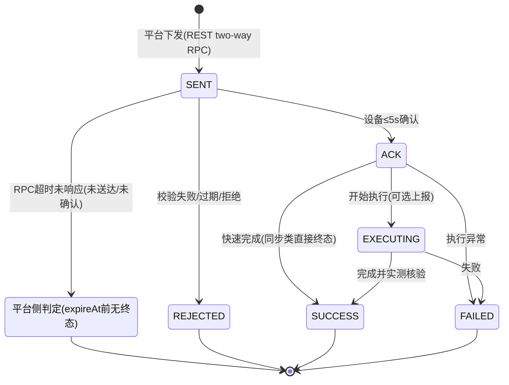
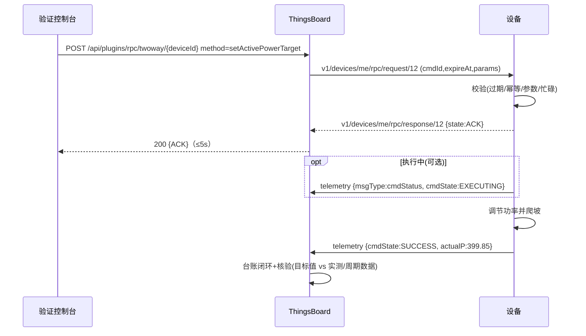
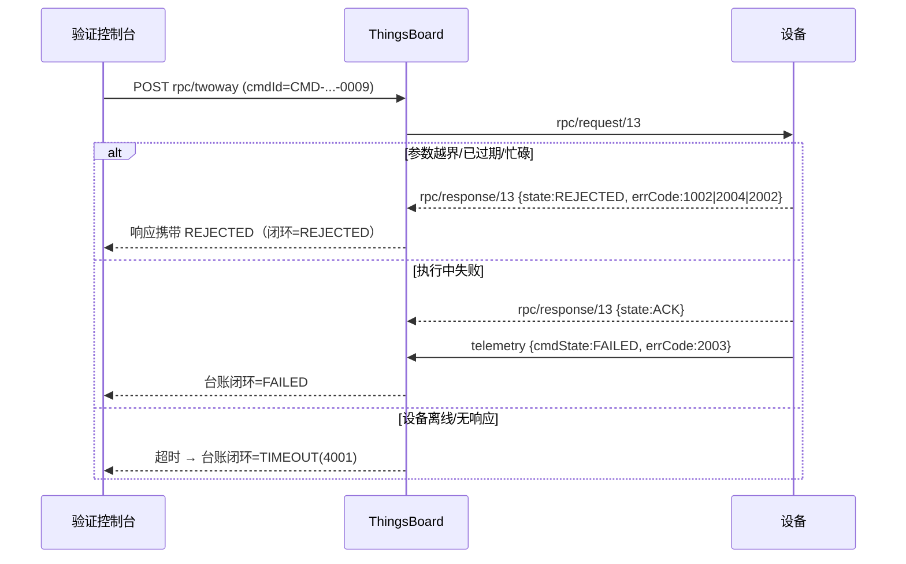
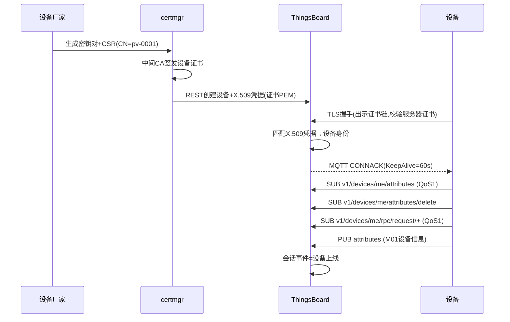
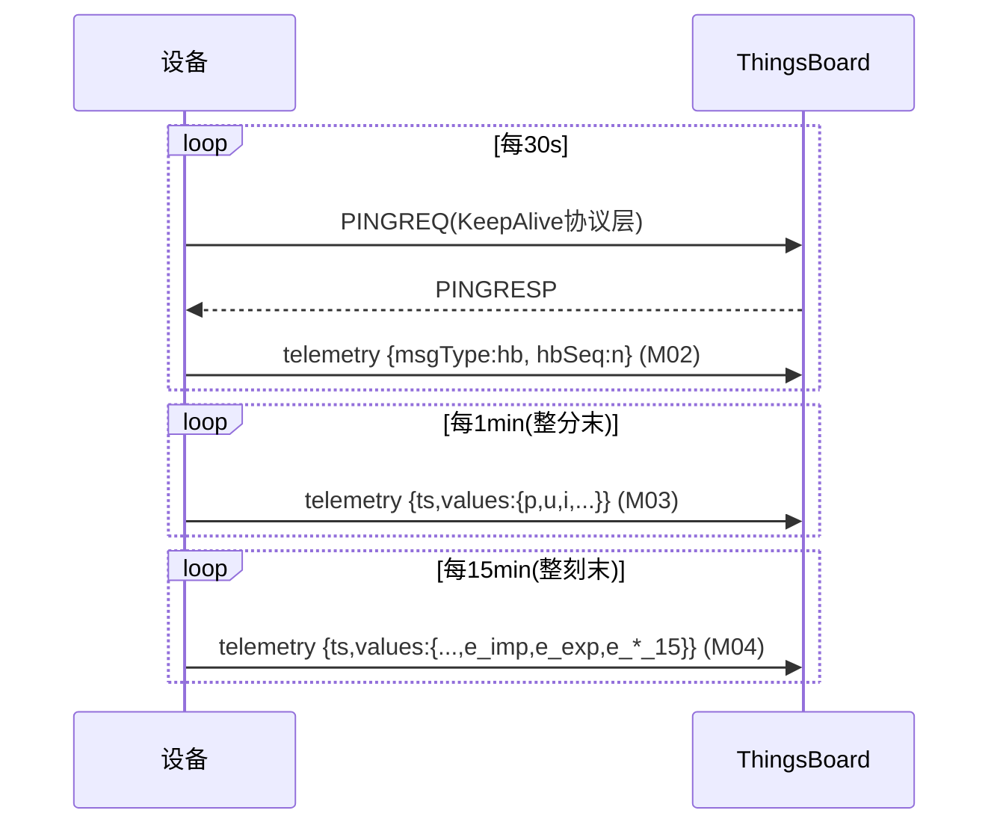
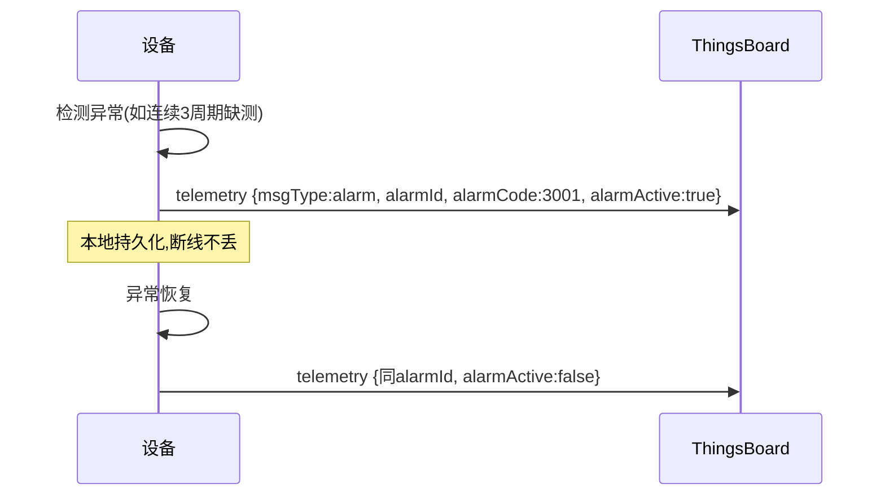
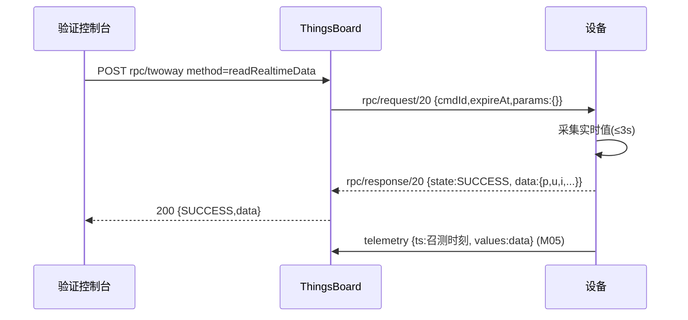

# 虚拟电厂物联交互报文规范

> **文档状态：已批准 v1.0（2026-11-03 人工批准，P1 门禁通过；P7 汇编终稿见《虚拟电厂物联设备通信与接入技术规范.md》）**
> 版本：v1.2 | 日期：2026-11-04 | 适用平台：ThingsBoard CE 3.5.1（固定镜像 `thingsboard/tb-postgres:3.5.1`）
> 版本记录：v1.0（2026-11-03 人工批准）→ v1.2（2026-11-04）：`devType=flex` 更名 `load`（负荷）、新增 `devType=wind`（风电）、`loadType` 编码表落地（§8.5）
> 说明：本项目工作区内无既有报文规范，本文档为基线规范，覆盖原有通用报文类型（遥测/属性/RPC/声明）及需求文档第二章要求的全部补充内容。
> 配套机器可读 Schema：`spec/schemas/`（与本文档同步维护，不一致时以本文档为准并同步修正）。

---

## 1. 总则

### 1.1 适用范围

本文档规定虚拟电厂（VPP）平台与接入设备（光伏逆变器、储能 PCS、负荷、风电）之间基于 MQTT 的全部交互报文，作为设备厂家适配依据与本项目开发、测试、验收基准。

### 1.2 协议基础

| 项 | 约定 |
|---|---|
| 传输协议 | MQTT 3.1.1，默认 MQTT over TLS（TLS 1.2+），对外端口 **18885**（容器内 8883；原规划 18883 因主机端口占用已于 P2 实测调整，见 docs/02 §1.2），X.509 双向认证 |
| 报文编码 | UTF-8，JSON（RFC 8259）；数值必须是 JSON number，禁止字符串数字 |
| 平台 | ThingsBoard CE 3.5.1 原生 MQTT API；**不允许自定义 TB 无法识别的 Topic**，业务语义全部承载于 payload 字段 |
| 时间戳 | `ts` 统一为 UTC 毫秒级 epoch（13 位整数），如 `1699000020000` |
| 命名 | 业务键名采用小驼峰（camelCase），遥测键采用短小写（如 `p`、`e_imp`，见数据字典第 8 章） |
| QoS | 全部业务报文默认 **QoS 1**；设备订阅 Topic 必须以 QoS≥1 订阅 |
| 单包大小 | ≤ 32 KB；历史批量补传 ≤ 100 条/包 |
| 字符串长度 | 未标注时 ≤ 128 字符；具体以数据字典为准 |

### 1.3 Topic 总表（全部为 TB 原生）

| # | Topic | 方向 | 用途 | QoS | 报文 |
|---|---|---|---|---|---|
| T1 | `v1/devices/me/telemetry` | 设备→平台 | 遥测：周期数据、心跳、告警、指令状态、实时快照、历史批量 | 1 | M02~M06、M11、M14 |
| T2 | `v1/devices/me/attributes` | 设备→平台 | 客户端属性上报（设备信息、调节约束） | 1 | M01、M07 |
| T3 | `v1/devices/me/attributes` | 平台→设备（订阅） | 共享属性下发 | 1 | M08 |
| T4 | `v1/devices/me/attributes/delete` | 平台→设备（订阅） | 共享属性删除通知 | 1 | M09 |
| T5 | `v1/devices/me/attributes/request/{reqId}` | 设备→平台 | 属性拉取请求（可选） | 1 | M10 |
| T6 | `v1/devices/me/attributes/response/{reqId}` | 平台→设备（订阅） | 属性拉取响应 | 1 | M10 |
| T7 | `v1/devices/me/rpc/request/{reqId}` | 平台→设备（订阅） | 服务端 RPC：召测、参数、控制指令 | 1 | M12 |
| T8 | `v1/devices/me/rpc/response/{reqId}` | 设备→平台 | RPC 即时响应（接收确认/查询结果） | 1 | M13 |
| T9 | `v1/devices/me/rpc/request/{reqId}` | 设备→平台 | 客户端 RPC：对时（可选） | 1 | M16 |
| T10 | `v1/devices/me/claim` | 设备→平台 | 设备认领（可选） | 1 | M15 |

> `{reqId}` 为 Topic 中的请求编号（整数），由发起方给出；RPC 响应必须回填请求 Topic 中的同一 `reqId`（TB 配对规则）。

---

## 2. 设备注册与连接认证

### 2.1 注册模型（平台预注册 + 证书绑定）

X.509 双向认证要求平台预先信任设备证书，故采用**平台侧预注册**：

1. 设备厂家生成设备密钥对与 CSR（CN = 设备唯一名称，如 `pv-0001`）；
2. 证书管理服务（certmgr）用中间 CA 签发设备证书，导出 `设备证书+私钥+证书链`；
3. certmgr 调用 TB REST API：创建设备（名称=CN，设备配置文件=对应类型 profile）→ 凭据类型置为 **X.509 Certificate**，值=设备证书 PEM；
4. 设备首次成功 MQTT 连接即视为"激活"，激活后立即上报 M01 设备信息。

> TB 3.5.1 确认支持逐设备 X.509 证书凭据；设备配置文件的"X.509 Certificates Chain"策略（中间 CA + CN 正则 + 自动建设备）为可选优化，启用与否不改变本文报文定义。

### 2.2 MQTT CONNECT 参数

| 参数 | 值 | 说明 |
|---|---|---|
| host:port | 平台地址:18885（TLS） | |
| clientId | `dev-{CN}`，全局唯一 | 重复 clientId 将互踢（后连挤前连） |
| username / password | 空 / 任意（以证书认证） | |
| clientCert | 设备证书 + 中间 CA + 根 CA 证书链（PEM） | |
| clientKey | 设备私钥 | 不入代码仓库 |
| keepAlive | 60 s（默认，可配 30~120 s） | 协议层保活；1.5×keepAlive 无报文平台断开连接 |
| cleanSession | false | 断线期间订阅由 TB 会话保持 |
| 订阅（连接成功后立即） | T3、T4、T7（QoS 1） | 未订阅 RPC 时指令无法送达 |

### 2.3 认证失败与处理

| 场景 | 结果 | 设备处理 |
|---|---|---|
| 证书过期/吊销/链不完整 | TLS 握手失败，无 CONNACK | 指数退避重连（1s 起×2，上限 60s，±20% 抖动），上报本地告警；证书过期不得无限重试（≥5 次后转入告警等待人工处理） |
| 凭据未绑定/设备被禁用 | CONNACK 后会话被拒/断开 | 同上退避重连 |
| clientId 冲突 | 互踢 | 检查 clientId 唯一性配置 |

### 2.4 关键概念区分（需求 2.1 明确项）

| 概念 | 层级 | 载体 | 用途 |
|---|---|---|---|
| MQTT Keep Alive | 协议层 | PINGREQ/PINGRESP | 仅维持 TCP/TLS 连接，无业务语义 |
| 业务心跳（M02） | 应用层 | 遥测（30s 默认） | 证明设备业务进程健康，携带业务状态摘要；连续缺失 ≥3 周期视为业务可疑（设备真上下线以 TB 会话事件为准） |
| 属性更新（M08） | 应用层 | 共享属性 | 配置类数据的"状态"语义：写入后长期有效，设备应用后回执；无请求-响应时效要求 |
| RPC 控制（M12） | 应用层 | 服务端 RPC | 一次性"动作"语义：有唯一业务编号、有效期、即时确认与异步终态的完整闭环 |

---

## 3. 消息清单总表

| 编号 | 名称 | 方向 | Topic | 触发时机 | Schema |
|---|---|---|---|---|---|
| M01 | 设备信息上报 | 设备→平台 | T2 | 首次连接后必发；型号/版本变更后必发 | `attributes-devinfo` |
| M02 | 业务心跳 | 设备→平台 | T1 | 周期（默认 30s） | `telemetry-heartbeat` |
| M03 | 1 分钟周期遥测 | 设备→平台 | T1 | 每分钟（周期末时刻） | `telemetry-1min` |
| M04 | 15 分钟周期遥测 | 设备→平台 | T1 | 每 15 分钟（整刻末） | `telemetry-15min` |
| M05 | 召测联动实时快照 | 设备→平台 | T1 | `readRealtimeData` 成功后必发 | `telemetry-1min`（ts=当前） |
| M06 | 历史数据批量补传 | 设备→平台 | T1 | 断线重连后 / `readHistoryData` 触发 | `telemetry-history-batch` |
| M07 | 调节能力与约束上报 | 设备→平台 | T2 | 变化即发，且至少每 15min 刷新 | `attributes-constraints` |
| M08 | 共享属性下发 | 平台→设备 | T3 | 平台侧配置变更 | `shared-attributes` |
| M09 | 共享属性删除通知 | 平台→设备 | T4 | 平台删除共享属性 | TB 原生 |
| M10 | 属性拉取请求/响应 | 设备⇄平台 | T5/T6 | 设备可选主动拉取 | TB 原生 |
| M11 | 告警/异常上报 | 设备→平台 | T1 | 告警产生/恢复时 | `telemetry-alarm` |
| M12 | 控制指令下发 | 平台→设备 | T7 | 平台发起召测/控制 | `rpc-request` |
| M13 | 指令即时响应 | 设备→平台 | T8 | 收到 M12 后 ≤5s | `rpc-response` |
| M14 | 指令状态/终态上报 | 设备→平台 | T1 | 执行中（可选）/终态（必发） | `telemetry-cmd-status` |
| M15 | 设备认领 | 设备→平台 | T10 | 可选（租户/客户绑定） | TB 原生 |
| M16 | 设备对时 | 设备⇄平台 | T9 | 可选 | TB 原生客户端 RPC |

---

## 4. 各报文详细规范

> 每类报文按固定模板描述：①业务用途及适用场景 ②发送方/接收方/方向 ③Topic、QoS 及消息格式 ④完整 JSON 示例与 Schema ⑤字段说明（名称/类型/单位/必填/取值范围）⑥请求-响应关联规则 ⑦超时、异常码及处理 ⑧时序图（第 11 章汇总）。

### 4.1 M01 设备信息上报（attributes-devinfo）

① **用途**：设备注册激活后向平台登记静态档案，供平台建档、厂家适配核验。
② **发送方**：设备；**接收方**：平台；**方向**：设备→平台（客户端属性 client scope）。
③ **Topic**：`v1/devices/me/attributes`，QoS 1。格式：扁平键值对象。
④ **示例**：

```json
{
  "devSn": "PV2026A0001",
  "devName": "pv-0001",
  "devType": "pv",
  "devModel": "INV-110KTL",
  "vendor": "VendorA",
  "swVer": "V2.1.3",
  "hwVer": "H1.0",
  "protocolVer": "vpp-1.0",
  "capKw": 110.0,
  "firstBootTs": 1699000000000
}
```

Schema：[attributes-devinfo.schema.json](../spec/schemas/attributes-devinfo.schema.json)
⑤ 字段：

| 字段 | 类型 | 单位 | 必填 | 取值/说明 |
|---|---|---|---|---|
| devSn | string | - | 是 | ≤32，序列号 |
| devName | string | - | 是 | ≤32，须与证书 CN 及 TB 设备名一致 |
| devType | string | - | 是 | `pv` / `pcs` / `load` / `wind`（v1.2 起 `flex` 更名 `load`，新增 `wind`） |
| devModel | string | - | 是 | ≤32 型号 |
| vendor | string | - | 否 | ≤32 厂家 |
| swVer / hwVer | string | - | 是/否 | ≤16 |
| protocolVer | string | - | 是 | 固定 `vpp-1.0` |
| capKw | number | kW | 是 | 设备额定容量，>0 |
| firstBootTs | integer | ms | 否 | 首次上电时间 |

⑥ **关联规则**：无请求方；平台以 `devName`（=设备名）归档，`protocolVer` 校验协议版本兼容性。
⑦ **超时/异常**：无响应报文。平台侧 60s 内未收到 M01 视为档案不完整，验证控制台标记；设备在 M01 发送失败时按退避重发（QoS1 已保证至少一次）。

### 4.2 M02 业务心跳（telemetry-heartbeat）

① **用途**：应用层存活与业务健康证明；与 MQTT KeepAlive 区分（见 2.4）。
② 设备→平台，遥测。
③ Topic：`v1/devices/me/telemetry`，QoS 1。格式：`{ts, values}` 包装（见 1.2 统一格式）。
④ 示例：

```json
{ "ts": 1699000030000,
  "values": { "msgType": "hb", "hbSeq": 1024, "runState": 2, "ctrlMode": 1, "uptimeSec": 86400 } }
```

Schema：[telemetry-heartbeat.schema.json](../spec/schemas/telemetry-heartbeat.schema.json)
⑤ 字段：`msgType`（string，必填，= `"hb"`）；`hbSeq`（int，必填，单调递增心跳序号，范围 0~4294967295）；`runState`（int，必填，见 8.3）；`ctrlMode`（int，必填：0 本地/1 远程）；`uptimeSec`（int，可选，设备连续运行秒数）。
⑥ 关联：无请求方；平台按 `hbSeq` 判断连续性，按 `ts` 判断新鲜度。
⑦ 超时/异常：心跳周期 `hbPeriodSec` 默认 30s（共享属性可配 10~300）；连续缺失 ≥3 周期，平台标记"业务心跳异常"告警提示（设备真实离线以 TB 会话事件为准）。

### 4.3 M03 1 分钟周期遥测（telemetry-1min）

① **用途**：实时功率与电气量周期上报，供 VPP 监视与功率曲线分析。
② 设备→平台，遥测。
③ Topic：`v1/devices/me/telemetry`，QoS 1。格式：`{ts, values}`；`ts`=**周期末时刻**（整分对齐，秒=0，允许 ±2s 偏差，超差 `dqf=1`）。
④ 示例（PCS 设备）：

```json
{ "ts": 1699000020000,
  "values": { "u": 380.2, "i": 759.8, "f": 50.001, "pf": 0.998, "p": 498.65, "q": 22.31, "s": 499.5,
              "t_dev": 45.2, "t_amb": 28.5, "soc": 82.4, "runState": 4, "dqf": 0 } }
```

Schema：[telemetry-1min.schema.json](../spec/schemas/telemetry-1min.schema.json)
⑤ 字段（详见数据字典 8.2）：必填 `p`（有功功率 kW）、`dqf`；其余按设备类型选报（见 8.5 类型专用）。无有效数据的测点**省略键**并使 `dqf≥1`，禁止上报 null。
⑥ 关联：无请求方；与 M04 同 channel 并行（1min 为瞬时监视口径，15min 为结算口径）。
⑦ 超时/异常：上报周期 1min；缺失处理与 dqf 定义见 8.6；连续 ≥3 周期缺测须发 M11（alarmCode=3001）。

### 4.4 M04 15 分钟周期遥测（telemetry-15min）

① **用途**：结算口径周期数据：功率均值 + 电量表码 + 区间电量增量，用于电量统计、聚合与结算核验。
② 设备→平台，遥测。
③ Topic：`v1/devices/me/telemetry`，QoS 1。格式：`{ts, values}`；`ts`=**周期末时刻**（UTC 毫秒，整刻对齐：分钟值 ∈ {0,15,30,45}，±2s 容差）。
④ 示例：

```json
{ "ts": 1699000500000,
  "values": { "u": 380.1, "i": 760.4, "p": 497.90, "pf": 0.998,
              "e_imp": 12345.678, "e_exp": 2345.678, "e_imp_15": 1242.315, "e_exp_15": 0.0,
              "e_day": 3120.442, "runState": 2, "dqf": 0 } }
```

Schema：[telemetry-15min.schema.json](../spec/schemas/telemetry-15min.schema.json)
⑤ 关键字段：在 M03 基础上增加——`e_imp`/`e_exp`（kWh，受进/送出**累计表码**，本周期末值，0~99999999.999）；`e_imp_15`/`e_exp_15`（kWh，本周期**区间增量**）；`e_day`（kWh，UTC+8 自然日 0 点起的累计，仅 PV/PCS 必报）。增量与表码规则、回绕/换表处理见 8.6。
⑥ 关联：`e_*_15` 与上周期表码存在校验关系（增量=末期−初期，回绕除外），平台自动核验。
⑦ 超时/异常：同 8.6；首周期（无基线）`e_*_15` 省略；表码异常（倒走且非回绕）按 `dqf=2` 上报并发 M11（3002）。

### 4.5 M05 召测联动实时快照

① **用途**：`readRealtimeData`（M12）召测成功后，将实时值固化入遥测库，供平台后续核验（RPC 响应仅送达发起方，遥测才可长期查询）。
② 设备→平台，遥测。
③ Topic：T1，QoS 1；格式与 M03 相同（`ts`=召测时刻，可不为整分）。
④⑤⑥⑦ 同 M03；要求：召测响应（M13，state=SUCCESS）**之后 ≤2s 内**发出本条遥测；键集与 M13 `data` 一致。

### 4.6 M06 历史数据批量补传（telemetry-history-batch）

① **用途**：断线期间缓存数据的断点补传；以及响应 `readHistoryData` 召测的历史回放。
② 设备→平台，遥测。
③ Topic：T1，QoS 1。格式：**TB 原生遥测数组** `[{ts, values}, ...]`，每条记录带原始 `ts`；≤100 条/包，包间间隔 ≥200ms；按时间**升序**发送。
④ 示例（2 条 1min 记录）：

```json
[
  { "ts": 1699000020000, "values": { "p": 480.12, "u": 380.5, "dqf": 0 } },
  { "ts": 1699000080000, "values": { "p": 492.77, "u": 380.1, "dqf": 0 } }
]
```

Schema：[telemetry-history-batch.schema.json](../spec/schemas/telemetry-history-batch.schema.json)
⑤ 字段：记录 `values` 为 M03 或 M04 键集（1min 与 15min 记录可分包发送，不混包）。
⑥ 关联：断线补传无需请求（设备自主）；召测回放与 `readHistoryData` 的 `callId` 对应（设备在 M13 响应中返回计划包数）。
⑦ 超时/异常：QoS1 保证至少一次；平台侧可能收到重复记录（按 ts 幂等去重）；补传不得重新插值改数，保持缓存原值与原 dqf。设备缓存容量 ≥24h（1440 条 1min + 96 条 15min，可配），溢出按最旧丢弃并计缺测。

### 4.7 M07 调节能力与约束上报（attributes-constraints）

① **用途**：申报设备当前可调节能力与运行约束，供 VPP 调度决策与指令合法性预校验。
② 设备→平台，客户端属性。
③ Topic：T2，QoS 1，扁平键值。
④ 示例（PCS）：

```json
{ "pMin": -500.0, "pMax": 500.0, "rampRate": 250.0,
  "qMin": -250.0, "qMax": 250.0,
  "socMin": 10.0, "socMax": 95.0, "chgPMax": 500.0, "disPMax": 500.0,
  "respTimeS": 5, "ctrlMode": 1, "regMode": "auto", "upTimeS": -1 }
```

Schema：[attributes-constraints.schema.json](../spec/schemas/attributes-constraints.schema.json)
⑤ 字段见 8.4。
⑥ 关联：平台下发控制指令前可参照本组约束；约束变化（含因 SOC 造成的充放上限变化）必须即时上报。
⑦ 超时/异常：无响应；平台侧 15min 未刷新视为约束过期，验证控制台提示。

### 4.8 M08 共享属性下发（shared-attributes）

① **用途**：平台向设备下发配置（状态语义，长期有效），如心跳周期、上报使能；与 RPC 控制（动作语义）区分（见 2.4）。
② **发送方**：平台；**接收方**：设备；**方向**：平台→设备（设备须订阅 T3）。
③ Topic：T3，QoS 1。格式：扁平键值对象，一次可含多个键。
④ 示例：

```json
{ "cfgVer": 12, "hbPeriodSec": 30, "tele1mEnable": true, "tele15mEnable": true, "logLevel": "info" }
```

Schema：[shared-attributes.schema.json](../spec/schemas/shared-attributes.schema.json)
⑤ 可配置字段：`cfgVer`（int，必填，配置版本，单调递增）；`hbPeriodSec`（10~300）；`tele1mEnable`/`tele15mEnable`（bool）；`logLevel`（`debug`/`info`/`warn`/`error`）。
⑥ **关联与应用确认**：设备收到后**整体原子校验**（全部合法才应用，否则整体拒绝），应用成功后立即经 T2 回报客户端属性：`{"cfgVerApplied": 12, "cfgApplyTs": 1699000000000, "cfgResult": 0}`；失败回报 `cfgResult=<错误码>`（1002 参数非法）。平台以 `cfgVer == cfgVerApplied` 判定"设备已应用"。
⑦ 超时/异常：设备应用时限 10s（收到→回报）；平台 30s 未见 `cfgVerApplied` 更新则标记下发未确认。`cfgVer` 回退（小于当前值）设备拒绝并回报 1002。

### 4.9 M09 共享属性删除通知

平台删除共享属性时经 T4 通知设备（TB 原生格式 `{"deleted":["key1"]}`）。设备恢复该键默认值并回报相应状态（如 `hbPeriodSec` 恢复 30）。本项目默认配置项不使用删除操作，此机制保留为原生兼容。

### 4.10 M10 属性拉取（可选）

设备主动拉取属性（TB 原生）：PUB `v1/devices/me/attributes/request/{reqId}`：

```json
{ "clientKeys": "devSn,swVer,cfgVerApplied", "sharedKeys": "cfgVer,hbPeriodSec" }
```

订阅 T6 收到 `v1/devices/me/attributes/response/{reqId}`：`{"client":{...},"shared":{...}}`。用于设备启动时对齐配置，超时 10s 未响应则重试 ≤3 次。

### 4.11 M11 告警/异常上报（telemetry-alarm）

① **用途**：设备侧异常（通信故障、数据缺失、越界、对时失败等）主动上报，含产生与恢复两个事件。
② 设备→平台，遥测。
③ Topic：T1，QoS 1。格式：`{ts, values}`，`ts`=上报时刻。
④ 示例：

```json
{ "ts": 1699000060000,
  "values": { "msgType": "alarm", "alarmId": "ALM-pv-0001-230", "alarmCode": 3001, "alarmLevel": 2,
              "alarmTs": 1699000059500, "alarmActive": true, "alarmDesc": "1min data missing 3 cycles" } }
```

Schema：[telemetry-alarm.schema.json](../spec/schemas/telemetry-alarm.schema.json)
⑤ 字段：`msgType`（=`"alarm"`，必填）；`alarmId`（string≤64，必填，同一起告警的唯一标识，恢复时复用）；`alarmCode`（int，必填，见告警字典 8.3.2）；`alarmLevel`（int，1 提示/2 一般/3 严重/4 事故，必填）；`alarmTs`（ms，告警产生/恢复时刻）；`alarmActive`（bool，true=产生，false=恢复，恢复事件必发且同 alarmId）；`alarmDesc`（≤128）；`refKey`/`refValue`（可选，关联测点）。
⑥ 关联：无请求方；平台按 `alarmId` 聚合同一起告警的生命周期。
⑦ 超时/异常：告警上报不可丢弃（本地持久化队列，QoS1）；重复去重按 alarmId+alarmTs。

### 4.12 M12 控制指令下发（rpc-request）

① **用途**：平台发起的召测、参数查询/配置与功率控制动作（完整状态闭环见第 5 章）。
② **发送方**：平台（验证控制台经 TB REST two-way RPC）；**接收方**：设备；**方向**：平台→设备（设备须订阅 T7）。
③ Topic：`v1/devices/me/rpc/request/{reqId}`，QoS 1。payload 为**指令信封**；Topic 中的 `reqId` 由 TB 分配，设备响应时必须原样回填。
④ 示例（有功目标值设置）：

```json
{ "cmdId": "CMD-20261103-0001", "issuedAt": 1699000000000, "expireAt": 1699000060000,
  "params": { "targetP": 400.0, "rampRate": 250.0, "durationS": 900 } }
```

> RPC `method` = `cmdType`（如 `setActivePowerTarget`），payload 信封中不再重复 `cmdType`。REST 请求体：
> `{"method":"setActivePowerTarget","params":{信封},"timeout":10000}`

Schema：[rpc-request.schema.json](../spec/schemas/rpc-request.schema.json)
⑤ 信封字段：`cmdId`（string≤64，**平台生成、全局唯一、幂等键**，格式建议 `CMD-YYYYMMDD-序号`）；`issuedAt`（ms，下发时刻）；`expireAt`（ms，指令有效期截止，默认 `issuedAt+60s`）；`params`（object，各 cmdType 见 5.2）。
⑥ **关联规则**：设备响应 Topic 回填同一 `reqId`；payload 回填同一 `cmdId`；执行终态经 M14 以 `cmdId` 关联。
⑦ **超时/异常**：设备收到已过期指令（`now > expireAt`）→ 直接 REJECTED（2004）；重复 `cmdId` → 幂等处理（5.3）；`timeout` 10s 内未收到 RPC 响应 → 平台判定送达失败（TIMEOUT-未送达）。

### 4.13 M13 指令即时响应（rpc-response）

① **用途**：设备对 M12 的即时确认：接收确认（ACK）、立即拒绝（REJECTED），或同步查询类命令直接返回终态与数据。
② 设备→平台。
③ Topic：`v1/devices/me/rpc/response/{reqId}`（reqId 原样回填），QoS 1。
④ 示例（接收确认 / 召测结果）：

```json
{ "cmdId": "CMD-20261103-0001", "state": "ACK", "errCode": 0, "errMsg": "", "ts": 1699000001200 }
```

```json
{ "cmdId": "CMD-20261103-0007", "state": "SUCCESS", "errCode": 0,
  "data": { "u": 380.2, "i": 759.8, "f": 50.001, "pf": 0.998, "p": 498.65, "q": 22.31,
            "soc": 82.4, "runState": 4, "dqf": 0 },
  "ts": 1699000230500 }
```

Schema：[rpc-response.schema.json](../spec/schemas/rpc-response.schema.json)
⑤ 字段：`cmdId`（必填）；`state`（必填，`ACK`/`EXECUTING`/`SUCCESS`/`FAILED`/`REJECTED`）；`errCode`（必填，第 9 章）；`errMsg`（≤128）；`data`（object，查询类 SUCCESS 时必填，见 `realtime-snapshot`/参数查询结果）；`dup`（bool，可选，幂等命中=true）；`ts`（必填）。
⑥ 关联：见 4.12⑥。
⑦ **超时**：设备必须在收到 M12 后 **≤5s** 发出 M13（任何状态）；查询类（readRealtimeData/getDeviceParams/readHistoryData 元信息）≤5s 返回终态。响应迟到无效（TB 已按超时结束）。

### 4.14 M14 指令状态/终态上报（telemetry-cmd-status）

① **用途**：控制类指令的异步过程与最终结果上报：`EXECUTING`（可选）与 `SUCCESS`/`FAILED`（必发终态），构成执行闭环；平台据此核验执行结果。
② 设备→平台，遥测。
③ Topic：T1，QoS 1，格式 `{ts, values}`。
④ 示例（终态-成功，含实测）：

```json
{ "ts": 1699000035000,
  "values": { "msgType": "cmdStatus", "cmdId": "CMD-20261103-0001", "cmdType": "setActivePowerTarget",
              "cmdState": "SUCCESS", "errCode": 0, "errMsg": "",
              "execTs": 1699000012000, "costMs": 3200, "actualP": 399.85 } }
```

Schema：[telemetry-cmd-status.schema.json](../spec/schemas/telemetry-cmd-status.schema.json)
⑤ 字段：`msgType`（=`"cmdStatus"`）；`cmdId`/`cmdType`/`cmdState`（`EXECUTING`/`SUCCESS`/`FAILED`）/`errCode`/`errMsg` 必填；`execTs`（开始执行时刻）；`costMs`（执行耗时）；终态必须携带**执行后实测键**（控制有功→`actualP`；功率限制→`actualPLimit`；充放电→`actualP`+`soc`；启停/模式→`runState`；参数配置→`applied` 对象）；`dup`（幂等重报=true）。
⑥ 关联：以 `cmdId` 关联 M12/M13；平台核验规则见 5.4。
⑦ 超时/异常：终态必须在 `expireAt` 前上报，否则平台判 TIMEOUT；设备执行中断线，重连后**补报终态**（`dup` 不需置位，属首次上报）。

### 4.15 M15 设备认领（可选，TB 原生）

PUB `v1/devices/me/claim`：`{"secretKey":"...","durationMs":60000}`。用于将预注册设备绑定到客户。本项目默认不启用，保留为原生能力。

### 4.16 M16 设备对时（可选，TB 原生客户端 RPC）

设备 PUB `v1/devices/me/rpc/request/{reqId}`：`{"method":"getTime","params":{}}`；平台规则链 script 节点回复 `{"serverTs":1699000000000}`。设备计算偏移，偏差 >2s 时发 M11（alarmCode=4001）。设备须自备 NTP，此机制仅作校验兜底。

---

## 5. 控制指令规范

### 5.1 指令状态机



状态定义：

| 状态 | 生成方 | 含义 | 载体 |
|---|---|---|---|
| SENT | 平台 | 已下发（设备在线投递） | 台账 |
| ACK | 设备 | 接收确认（M13） | RPC 响应 |
| EXECUTING | 设备 | 执行中（可选，M14） | 遥测 |
| SUCCESS | 设备 | 执行成功（M13 同步类 / M14 终态） | RPC/遥测 |
| FAILED | 设备 | 执行失败（errCode≠0） | RPC/遥测 |
| REJECTED | 设备 | 拒绝执行：过期(2004)/忙碌(2002)/参数非法(1002)/条件不满足(2003)/未就绪(2001) | M13 |
| TIMEOUT | 平台 | expireAt 前未收到终态（含未送达） | 台账（errCode=4001） |

### 5.2 指令清单（cmdType 与 params）

| cmdType（=RPC method） | 名称 | params 字段（均含于 `params` 对象） | 响应方式 |
|---|---|---|---|
| `readRealtimeData` | 实时数据召测 | 无（`{}`）；可选 `keys`（string[]，指定键） | 同步：M13 SUCCESS+`data`（realtime-snapshot），随后 ≤2s 发 M05 |
| `readHistoryData` | 历史数据召测 | `startTs`、`endTs`（ms，必填）；`interval`（1/15 min，默认 1）；`callId`（string≤32，平台生成，必填） | 同步元信息：M13 SUCCESS+`{"callId":..., "plannedBatches":n, "records":m}`，随后按 M06 批量回放 |
| `getDeviceParams` | 设备参数查询 | `keys`（string[]，空/缺省=全部） | 同步：M13 SUCCESS+`data`（参数键值） |
| `setDeviceParams` | 设备参数配置 | 参数键值对（≤20 键） | 异步：M13 ACK → M14 终态（`applied`） |
| `setActivePowerTarget` | 有功功率目标值设置 | `targetP`（kW，必填，受 8.4 约束）；`rampRate`（kW/min，可选，缺省用设备默认）；`durationS`（可选，有效期秒，缺省持续） | 异步：ACK → M14 终态（`actualP`） |
| `setMaxPowerLimit` | 最大功率限制 | `maxP`（kW，必填，0~capKw）；`scope`（`gen`/`chg`/`dis`，必填：发电上限/充电上限/放电上限） | 异步：ACK → M14 终态（`actualPLimit`） |
| `setRunMode` | 启动/停止/模式调整 | `action`（`start`/`stop`，与 `mode` 至少一项）；`mode`（`auto`/`manual`） | 异步：ACK → M14 终态（`runState`） |
| `setChargeDischargePower` | 储能充放电功率设置 | `p`（kW，必填，**正=放电，负=充电**）；`durationS`（可选）；`socFloor`/`socCeil`（%，可选保护边界） | 异步：ACK → M14 终态（`actualP`+`soc`） |

参数合法性由设备按 8.4 约束校验；越界 → REJECTED 1002。

### 5.3 幂等与重复指令

- 设备维护指令台账（cmdId → 终态结果），保留 ≥24h；
- 收到 `cmdId` 已有**终态**：直接按原终态回 M13（终态类）并置 `dup=true`，M14 终态重报置 `dup=true`；**不得重复执行**；
- 收到 `cmdId` **执行中**：回 M13 `ACK`（或 `EXECUTING`），不重复执行；
- 平台侧：同 `cmdId` 禁止二次下发；重试必须换新 `cmdId`（可携带台账备注 `retryOf`，设备无感知）；
- 查询类（read*/get*）天然幂等，仍按 cmdId 台账记录。

### 5.4 超时处理与执行结果核验

| 时限 | 值 | 判定方 | 动作 |
|---|---|---|---|
| M13 即时响应 | ≤5s | 平台（REST timeout=10000ms） | 超时 → 台账 TIMEOUT(4001)，不重发（换 cmdId 由人工/上层决定） |
| 查询类终态 | ≤5s | 设备保证 | |
| 终态（M14） | ≤ expireAt（默认下发后 60s） | 平台 | 未收到 → TIMEOUT(4001)；设备迟到终态仍入台账并标"迟到" |
| 执行核验 | 终态后 | 平台控制台 | SUCCESS 且携带实测：|targetP−actualP| ≤ max(2%·|targetP|, 约束分辨率) → 核验通过；核验通过需另有 M05/周期数据佐证（非仅模拟器发送日志） |

并发约束：同一设备同一时刻**至多 1 个控制类指令执行中**；执行中收到新控制指令 → REJECTED(2002)；查询类不受限。

### 5.5 指令闭环时序图

成功（异步控制类）：



拒绝与失败：



---

## 6. 交互机制时序图（接入/遥测/属性/补传/告警）

设备注册与认证接入：



周期遥测与业务心跳：



共享属性下发与应用确认：

```mermaid
sequenceDiagram
    participant C as 平台/控制台
    participant TB as ThingsBoard
    participant D as 设备
    C->>TB: REST 保存共享属性(cfgVer=12,hbPeriodSec=30,...)
    TB->>D: v1/devices/me/attributes {cfgVer:12,...}
    D->>D: 原子校验(合法→应用;非法→整体拒绝)
    D->>TB: attributes {cfgVerApplied:12,cfgApplyTs,cfgResult:0}
    C->>TB: 轮询/查询 cfgVerApplied==12 → 已应用
```

断线重连与断点补传：

```mermaid
sequenceDiagram
    participant D as 设备
    participant TB as ThingsBoard
    Note over D: 网络中断<br/>缓存1min/15min数据(≥24h)
    TB->>TB: 会话事件=设备离线
    Note over D: 指数退避重连(1s×2,上限60s,抖动20%)
    D->>TB: 重连成功(CONNACK)+重新订阅T3/T4/T7
    TB->>TB: 会话事件=设备上线
    D->>TB: attributes {cacheCount,cacheFromTs,cacheToTs}
    loop 按时间升序,≤100条/包,间隔≥200ms
        D->>TB: telemetry [{ts,values},...] (M06)
    end
    Note over TB: 按ts入库;最新值保护见8.6
```

告警上报与恢复：



召测（readRealtimeData）：



---

## 7. 错误码总表

| errCode | 含义 | 适用 | 处理要求 |
|---|---|---|---|
| 0 | 成功 | 全部 | - |
| 1001 | 参数缺失 | 指令 | REJECTED/FAILED，errMsg 注明缺哪个 |
| 1002 | 参数非法/越界 | 指令/属性 | REJECTED；共享属性→cfgResult=1002 整体拒绝 |
| 1003 | 设备内部错误 | 指令/上报 | FAILED，可重试由平台决定 |
| 1004 | 不支持的命令类型 | 指令 | REJECTED |
| 1005 | 报文格式错误（JSON 解析失败） | 指令 | REJECTED |
| 2001 | 设备未就绪（停机/检修） | 控制类 | REJECTED |
| 2002 | 忙碌（已有控制指令执行中） | 控制类 | REJECTED |
| 2003 | 运行条件不满足（SOC 越限、电网异常等） | 控制类 | REJECTED 或执行中 FAILED |
| 2004 | 指令已过期 | 控制类 | REJECTED |
| 2005 | 重复指令 | 全部 | 幂等命中，返回原结果（dup=true） |
| 3001 | 与下级/子设备通信故障 | 上报 | M11 |
| 4001 | 平台超时判定 | 台账 | 平台生成，非设备上报 |

告警字典（alarmCode）见 8.3.2。

---

## 8. 设备数据字典

### 8.1 通用设备信息（M01/M07 承载）

见 4.1、4.7 字段表。附加台账键（客户端属性，可选）：`cacheCount`、`cacheFromTs`、`cacheToTs`（补传水位）、`meterResetTs`（换表清零时刻）。

### 8.2 电气量与电量测量数据

| 键 | 名称 | 单位 | 类型 | 精度 | 范围 | 报文 | 必填 |
|---|---|---|---|---|---|---|---|
| u | 交流电压 | V | number | 0.1 | 0~100000 | M03/M04/M05/M06 | 否 |
| i | 交流电流 | A | number | 0.01 | 0~10000 | 同上 | 否 |
| p | 有功功率 | kW | number | 0.01 | −100000~100000（负=充电/受电） | 同上 | **是** |
| q | 无功功率 | kvar | number | 0.01 | ±100000 | 同上 | 否 |
| s | 视在功率 | kVA | number | 0.01 | 0~150000 | 同上 | 否 |
| pf | 功率因数 | - | number | 0.001 | −1~1（放电/发电为正） | 同上 | 否 |
| f | 频率 | Hz | number | 0.001 | 45~65 | 同上 | 否 |
| t_dev / t_amb | 设备/环境温度 | ℃ | number | 0.1 | −60~150 | 同上 | 否 |
| e_imp | 受进有功电量（累计表码） | kWh | number | 0.001 | 0~99999999.999 | M04/M06(15) | 15min 必填 |
| e_exp | 送出有功电量（累计表码） | kWh | number | 0.001 | 0~99999999.999 | M04/M06(15) | 15min 必填 |
| e_imp_15 / e_exp_15 | 区间电量增量 | kWh | number | 0.001 | 0~99999.999 | M04/M06(15) | 有基线后必填 |
| e_day | 当日累计（UTC+8 日 0 点复位） | kWh | number | 0.001 | 0~999999.999 | M04 | PV/PCS 必填 |

### 8.3 运行状态与告警

#### 8.3.1 runState 运行状态码

| 值 | 含义 | | 值 | 含义 |
|---|---|---|---|---|
| 0 | 未知 | | 5 | 停机（人为） |
| 1 | 待机 | | 6 | 故障停机 |
| 2 | 运行/发电 | | 7 | 检修 |
| 3 | 充电（PCS） | | 8 | 受限运行（限功率中） |
| 4 | 放电（PCS） | | | |

#### 8.3.2 告警字典（alarmCode）

| 码 | 含义 | 默认级别 | 码 | 含义 | 默认级别 |
|---|---|---|---|---|---|
| 1001 | 下级/子设备通信中断 | 3 | 3001 | 周期数据连续缺失 | 2 |
| 1002 | 采样/传感器故障 | 3 | 3002 | 数据越界（超物理范围被拒） | 2 |
| 1003 | 内部存储故障 | 3 | 3003 | 补传缓存溢出（最旧丢弃） | 2 |
| 1004 | 本地时钟同步失败 | 2 | 9001 | 其他（alarmDesc 必填） | 2 |
| 2001~2005 | 电压/电流/频率/温度/功率越限 | 3 | 4001 | 对时偏差 >2s | 1 |

> alarmCode 与 errCode 命名空间独立。级别可按设备实际情况上调；恢复事件（alarmActive=false）不重复计级别。

### 8.4 调节能力及运行约束（M07）

| 键 | 名称 | 单位 | 类型 | 精度 | 范围/说明 |
|---|---|---|---|---|---|
| pMin / pMax | 有功调节下/上限 | kW | number | 0.01 | pMin 可为负（PCS 充电） |
| rampRate | 有功爬坡速率 | kW/min | number | 0.01 | >0 |
| qMin / qMax | 无功调节上下限 | kvar | number | 0.01 | |
| socMin / socMax | SOC 允许下/上限 | % | number | 0.1 | 0~100（仅 PCS 必报） |
| chgPMax / disPMax | 最大充电/放电功率 | kW | number | 0.01 | ≥0（仅 PCS 必报，随 SOC 动态变化须即时刷新） |
| respTimeS | 指令响应预期时间 | s | int | - | 1~300 |
| ctrlMode | 控制模式 | - | int | - | 0 本地 / 1 远程 |
| regMode | 调节模式 | - | string | - | `auto` / `manual` |
| upTimeS | 可持续调节时长 | s | int | - | −1=不限 |

指令参数校验依据：`pMin≤targetP≤pMax`、`|ΔP| ≤ rampRate×durationS`（不满足则按 rampRate 爬坡至目标）、充放电 `p` 受 `chgPMax/disPMax` 与 SOC 边界约束。

### 8.5 设备类型专用数据

**光伏逆变器（devType=pv）**（M03/M04/M06 可选键）：

| 键 | 名称 | 单位 | 精度 | 范围 |
|---|---|---|---|---|
| dc_u / dc_i | 直流电压/电流 | V / A | 0.1 / 0.01 | 0~1500 / 0~2000 |
| dc_p | 直流功率 | kW | 0.01 | 0~capKw×1.2 |
| irradi | 辐照度 | W/m² | 0.1 | 0~2000 |
| t_mod | 组件温度 | ℃ | 0.1 | −40~120 |

**储能 PCS（devType=pcs）**：

| 键 | 名称 | 单位 | 精度 | 范围 |
|---|---|---|---|---|
| soc / soh | 荷电/健康状态 | % | 0.1 | 0~100 |
| cellVMax / cellVMin | 单体电压最大/最小 | V | 0.001 | 0~5 |
| cellTMax / cellTMin | 单体温度最高/最低 | ℃ | 0.1 | −40~90 |
| cycCnt | 循环次数 | 次 | int | ≥0 |

**负荷（devType=load，v1.2 起，原"柔性负荷控制器"devType=flex 更名）**：

| 键 | 名称 | 单位 | 精度 | 范围 |
|---|---|---|---|---|
| loadType | 负荷分类码 | - | int | **1~99 编码表（devType=load 必填，建档时登记）**：1 空调负荷 / 2 充电桩负荷 / 3 电采暖·热泵 / 4 照明 / 5 工业电机 / 6 数据中心 / 7 水泵 / 20~99 厂家自定义 |
| adjUpCap / adjDownCap | 可上调/可下调容量 | kW | 0.01 | ≥0 |
| shedState | 切除状态 | - | int | 0 未切除 / 1 已切除 / 2 部分切除 |

负荷特征参数（模拟器侧配置接口 `POST /api/devices/{name}/load-profile`，字段定义见
`simulator/backend/app/devices.py` DeviceConfig；仅 load/wind 类型可用，空字段保持不变）：

| 参数 | 类型/单位 | 默认 | 取值/语义 |
|---|---|---|---|
| loadType | int | 1 | 负荷分类码（同上编码表） |
| baseRatio | -（0~1） | 0 | 基线负荷率：>0 时功率≈baseRatio×capKw（受电为负）；0=按 loadType 特征曲线 |
| noiseAmp | -（0~0.3） | 0.08 | 随机波动幅度 |
| dutyOnMin / dutyOffMin | min | 0 | 占空启停：运行/停运分钟数；二者同时 >0 启用、同时 0 关闭（停运窗口功率爬坡回零） |
| windSpeedAvg | m/s（1~25） | 8 | 平均风速（仅 devType=wind 生效） |

**风电（devType=wind，v1.2 新增，与光伏并列的发电类设备）**：

| 键 | 名称 | 单位 | 精度 | 范围 |
|---|---|---|---|---|
| windSpeed | 实时风速 | m/s | 0.1 | 0~60 |

> 有功出力随风速变化（模拟器按风速三次方模型计算，`p`≥0 发电方向）；`capKw` 为装机容量；
> 平均风速经负荷特征接口配置（`windSpeedAvg`，默认 8 m/s）。

### 8.6 统计口径、精度、质量标识与缺失处理

**统计口径**：

| 数据 | 时间戳 ts | 功率口径 | 电气量口径 | 电量口径 |
|---|---|---|---|---|
| 1min（M03） | 周期末（整分，±2s） | 分钟内有功瞬时算术平均（设备内部采样 ≥1 次/10s） | u/i 为 RMS 平均，f/pf 为平均 | 不上报 |
| 15min（M04） | 周期末（整刻 0/15/30/45 分，±2s） | 15min 平均功率 | 同上 | 累计表码（周期末值）+ 区间增量（末−初） |

- 时钟：分钟边界偏差 >2s 的数据 `dqf=1`；`e_day` 按 UTC+8 自然日复位；
- `e_day`、`e_imp/e_exp` 单调性要求见下；净电量口径：`e_exp − e_imp`（VPP 聚合用）。

**数据质量标识 dqf（报文级，必填）**：

| 值 | 含义 |
|---|---|
| 0 | 全部测点有效 |
| 1 | 可疑（时间不对齐/采样抖动/个别测点可疑） |
| 2 | 无效周期（部分测点缺测或越界，缺测键已省略） |
| 3 | 补录/插值（仅补传原值标注沿用；平台侧插值只用于展示层，不写入原始序列） |

**缺失与异常数据处理要求**：

1. 测点无效→**省略该键**，`dqf≥2`；禁止上报 null 或 0 顶替；
2. 连续 ≥3 周期缺测→M11（3001）；数据越界→拒测点 + M11（3002）；
3. 断线缓存 ≥24h，重连后按 M06 升序补传，保持原值原 dqf；
4. 累计表码**回绕**：上限 99999999.999 后回 0；平台/设备增量算法：`增量 = 末 − 初`，若 `末 < 初 且 初 > 90000000` → `增量 = 末 + (99999999.999 − 初) + 0.001`；
5. **换表清零**：设备必须先发 M11（9001，alarmDesc 含 `meterReset`）并置客户端属性 `meterResetTs`；平台重置基线，该周期 `e_*_15` 按新表码起点计算；
6. 首周期无基线：`e_*_15` 省略，仅报表码；
7. 平台"最新遥测值"保护：补传旧数据会覆盖 TB latest telemetry，验证控制台一律按**时间范围查询**取数；可选在规则链增加"丢弃 ts 早于最新值"的脚本节点（实现阶段实测后固化，见 docs/02）。

---

## 9~10. 超时与参数总表

| 参数 | 默认值 | 可配范围 | 说明 |
|---|---|---|---|
| MQTT KeepAlive | 60s | 30~120s | 协议层 |
| hbPeriodSec 业务心跳周期 | 30s | 10~300s（共享属性） | 连续缺失 ≥3 周期→业务可疑 |
| M13 即时响应时限 | 5s | 固定 | 设备保证 |
| 平台 RPC timeout（REST） | 10000ms | ≥5000ms | TB 默认 |
| expireAt 有效期偏移 | issuedAt+60s | 按指令覆盖 | 终态时限 |
| 重连退避 | 1,2,4,…,≤60s | 固定 | ±20% 抖动 |
| 补传批量/间隔 | ≤100 条 / ≥200ms | 固定 | 升序，QoS1 |
| 属性应用时限 | 10s | 固定 | 收到 M08→回报 |
| 约束刷新 | ≤15min | 变化即发 | M07 |

---

## 11. 版本与兼容性

- 协议版本号：`protocolVer = "vpp-1.0"`（M01 上报）；新增可选键不升版；删除/改义键、新增必填键必须升版并全量回归；
- 指令扩展：新增 `cmdType` 时设备应回 REJECTED(1004) 而非静默丢弃；
- 本规范与代码/Schema 同步：修改必须同步更新 `spec/schemas/`、模拟器、测试用例，并在终稿文档中记录变更。

## 附录 A：JSON Schema 清单（spec/schemas/）

| 文件 | 对应报文 | | 文件 | 对应报文 |
|---|---|---|---|---|
| `_common.schema.json` | 公共定义 | | `telemetry-alarm.schema.json` | M11 |
| `rpc-request.schema.json` | M12 | | `telemetry-cmd-status.schema.json` | M14 |
| `rpc-response.schema.json` | M13 | | `attributes-devinfo.schema.json` | M01 |
| `telemetry-heartbeat.schema.json` | M02 | | `attributes-constraints.schema.json` | M07 |
| `telemetry-1min.schema.json` | M03/M05 | | `shared-attributes.schema.json` | M08 |
| `telemetry-15min.schema.json` | M04 | | `realtime-snapshot.schema.json` | M13 data（召测） |
| `telemetry-history-batch.schema.json` | M06 | | | |

## 附录 B：与 ThingsBoard 原生能力对照

| 需求能力 | TB 原生 | 自研 | 设备厂家实现 |
|---|---|---|---|
| X.509 双向认证、设备凭据 | 是（REST+传输层） | certmgr 自动签发/绑定 | 生成密钥对/CSR、TLS 客户端 |
| Topic 路由/鉴权/QoS | 是（MQTT API） | 无 | 正确订阅/发布 |
| 遥测/属性存储与时序查询 | 是 | 控制台查询封装 | 数据采集与打点 |
| RPC 下发与响应配对 | 是（requestId 配对） | 指令台账/超时判定/核验（控制台） | 响应回填 reqId、终态上报 |
| 设备上下线事件 | 是（会话事件） | 台账展示 | 无需上报 |
| 告警 | TB Alarm 可选映射 | 验证控制台以遥测告警键为准 | 告警检测与上报 |
| 证书吊销（CRL/OCSP） | 3.5.1 CE 无原生吊销页 | **自研**：certmgr 记录吊销名单 + 禁用设备凭据（REST 禁用设备等效吊销） | 证书更新 |
