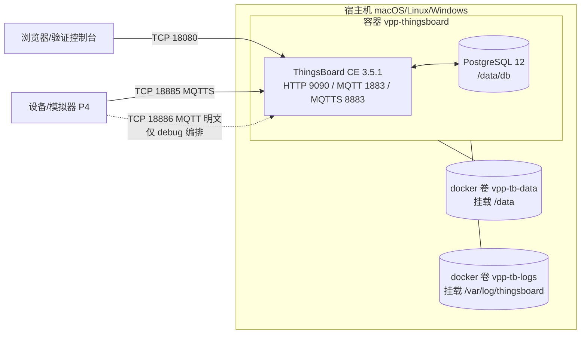

# 系统架构与部署手册（P2）

> 版本：v1.0 | 日期：2026-11-03 | 适用镜像：`thingsboard/tb-postgres:3.5.1`（固定）
> 本文所有"实测记录"均为本机真实运行结果；未实际执行的操作明确标注"未验证"。

## 1. 部署架构

### 1.1 组件形态（实测确认）

采用 ThingsBoard 官方**单体镜像** `thingsboard/tb-postgres:3.5.1`：单容器内同时运行
ThingsBoard CE 3.5.1（Java 11）与内嵌 PostgreSQL 12（`PGDATA=/data/db`），经镜像内
`start-tb.sh` 编排：



要点（均经镜像内实查核实）：

| 项 | 事实 | 出处 |
|---|---|---|
| 入口 | `CMD start-tb.sh`（`/usr/bin/start-tb.sh`） | `docker image inspect` |
| 首次启动 | 自动执行 `install-tb.sh --loadDemo` 初始化库表与演示数据，完成写标志 `/data/.firstlaunch`，此后不再初始化 | 脚本内容实查 |
| 内嵌数据库 | PostgreSQL 12（`PG_MAJOR=12`，`SPRING_DATASOURCE_URL=jdbc:postgresql://localhost:5432/thingsboard`）——**无独立数据库容器** | 镜像 Env 实查 |
| HTTP 服务 | 容器内 9090（`HTTP_BIND_PORT=9090`） | 镜像 Env 实查 |
| MQTT 明文 | 容器内 1883 默认开启（`MQTT_ENABLED:true` 默认） | `thingsboard.yml` 实查 |
| MQTT TLS | **默认关闭**（`MQTT_SSL_ENABLED:false` 默认），支持 PEM 证书（`MQTT_SSL_CREDENTIALS_TYPE=PEM`，证书/私钥路径/密码均可配）——P3 阶段启用并挂载自建 PKI | `thingsboard.yml` 实查 |

### 1.2 端口规划（对外统一 1xxxx）

| 对外端口 | 容器端口 | 用途 | 状态 |
|---|---|---|---|
| 18080 | 9090 | TB Web UI / REST API | 已启用（实测 200） |
| 18885 | 8883 | MQTT over TLS（主接入） | P3 已启用（自签 PKI 实测双向 TLS） |
| 18886 | 1883 | MQTT 明文（仅调试） | 默认关闭，经 debug 编排开启 |
| 19000 | 9000 | 设备模拟器（profile=simulator，可选） | P4 已交付 |
| 19001 | 9001 | 证书管理工具 certadmin（独立编排 vpp-certadmin） | v1.3 已交付（实测） |
| — | 5432 | PostgreSQL | 不对外（容器内 localhost） |

> **端口变更说明**：原规划 MQTTS 18883、明文调试 18884。实测本机 18883 已被既有
> ThingsBoard 项目容器（`thingsboard`，18883→1883）占用、18884 被 `device-broker`
> 占用，依据需求"避免和主机已有服务端口冲突"，本项目调整为 **18885 / 18886**
> （可在 `deploy/.env` 修改）。规划文档 `00-项目总体规划.md` 已同步修正。

## 2. 部署文件清单

```
deploy/
├── docker-compose.yml           # 主编排：TB 单体服务 + 命名卷 + 健康检查
├── docker-compose.debug-mqtt.yml # 覆盖编排：暴露 MQTT 明文 18886（仅调试）
├── .env.example                 # 环境变量模板
├── .env                         # 本机实例（由模板复制，不入代码仓库）
└── certs/server/                # TB 服务器证书装配目录（certadmin 导出后线下覆盖，不入仓库）
certadmin/                       # 证书管理工具（v1.3，独立编排 vpp-certadmin，可异机部署）
├── backend/ frontend/ Dockerfile docker-compose.yml
└── data/                        # CA 与证书数据（平台信任根，不入仓库，务必备份）
```

`docker-compose.yml` 关键设计：

- **固定镜像**：`${TB_IMAGE:-thingsboard/tb-postgres:3.5.1}`，版本锁定；
- **持久化**：命名卷 `vpp-tb-data`（/data，含内嵌 PG 数据）与 `vpp-tb-logs`
  （/var/log/thingsboard）；命名卷在 Linux Docker Engine 与 Windows Docker Desktop
  下行为一致，避免 bind mount 的权限/性能问题；
- **健康检查**：容器内无 curl/nc，使用 `wget -q -O /dev/null http://127.0.0.1:9090/login`
  （间隔 30s，`start_period=300s` 容纳首次建库耗时）；
- **故障恢复**：`restart: unless-stopped` + `stop_grace_period: 1m`（TB 优雅停机含内嵌
  PG 的 stop-db.sh）；
- **初始化**：镜像自带首启 `install-tb.sh --loadDemo`（演示数据便于登录验证；
  如需纯净环境需自定义入口脚本，本项目验证场景保留演示数据）；
- **日志轮转**：`json-file`，单容器 200MB×10；
- **资源**：默认 `JAVA_OPTS=-Xms512m -Xmx1536m`；实测宿主机 Docker VM 配置
  10 CPU / 8GB 内存满足运行（见 §4 实测环境）。

## 3. 部署与运维命令

### 3.0 部署顺序（依赖链，v1.3 起必须遵循）

v1.3 起所有证书由 certadmin 统一签发，组件上线必须按以下顺序执行（证书详细流程见 docs/03 §4）：

| # | 步骤 | 前置依赖 |
|---|---|---|
| 1 | 部署 certadmin（独立编排，首启自动生成根 CA + 中间 CA） | 无（可与 TB 异机） |
| 2 | certadmin 签发 TB 服务器证书 → 导出 server 装配包 → **线下覆盖 `deploy/certs/server/`** | 步骤 1（docs/03 §4.2 阶段一） |
| 3 | 部署 TB（只读挂载 `deploy/certs/`，truststore 信任 certadmin 根 CA） | 步骤 2 |
| 4 | certadmin 签发设备证书 → 线下交付并导入模拟器/烧录设备 | 步骤 1（docs/03 §4.3/4.4） |
| 5 | 部署模拟器（已信任平台根证书、已导入设备证书）→ 注册 → 连接 TB | 步骤 3、4 |

> certadmin 不依赖 TB，可最先部署；模拟器必须最后上线（依赖 TB 在线、平台根证书与设备证书就绪）。
> 证书装配完成后，日常重启各组件顺序无要求；仅**首次部署**或**更换 CA** 时必须严格按上表执行。

### 3.1 certadmin 证书管理工具（独立编排 vpp-certadmin，:19001）

`scripts/vpp.sh` 仅覆盖 TB 编排；certadmin 为独立 compose 工程，与 TB/模拟器解耦、可异机部署，
在**仓库根目录**执行（镜像构建上下文为仓库根，依赖 `certmgr/` 源码）：

```bash
docker compose -f certadmin/docker-compose.yml up -d --build   # 构建并启动（对外 19001 → 容器 9001）
docker compose -f certadmin/docker-compose.yml ps              # 状态
docker compose -f certadmin/docker-compose.yml logs -f         # 日志（就绪标志：Uvicorn running + CA 初始化日志）
docker compose -f certadmin/docker-compose.yml restart         # 重启
docker compose -f certadmin/docker-compose.yml stop | start    # 停止/启动（保留容器与数据）
docker compose -f certadmin/docker-compose.yml down            # 移除容器（certadmin/data/ 保留）
curl http://127.0.0.1:19001/api/health                         # 健康检查：{"status":"ok","caInitialized":true}
```

要点：

- **首启幂等初始化**根 CA + 中间 CA（已存在则跳过）；CA 默认已生成，仅查看/导出，无生成入口；
- **数据持久化**：`certadmin/data/` → 容器 `/data/secrets`（根/中间 CA 私钥、签发登记簿
  `registry.json`、设备/服务器证书）。该目录即平台信任根，**丢失 = 全部已签发证书作废**，
  务必定期备份（如 `tar czf certadmin-data-$(date +%Y%m%d).tgz certadmin/data`，建议容器停止时备份）；
- **可调参数**（环境变量）：`CERTADMIN_HTTP_PORT`（默认 19001）、`CERTADMIN_IMAGE`
  （默认 `vpp-certadmin:1.0.0`）、`TZ`（默认 Asia/Shanghai）；
- **异机部署**：拷贝完整仓库后同上构建运行（构建需 `certmgr/` + `certadmin/`）；工具不联网对接
  TB，交付物（root-ca.pem / TB 服务器装配包 / 设备证书交付包）均经 UI 导出后线下分发（流程见 docs/03）；
- **日志轮转**：json-file 单容器 20MB×5。

### 3.2 ThingsBoard 平台（deploy/ 编排）

在 `deploy/` 目录执行：

```bash
cp .env.example .env        # 首次；按需修改端口/JVM
docker compose up -d        # 启动（首次自动建库，约 1~3 分钟）
docker compose ps           # 状态（等待 healthy）
docker compose logs -f      # 日志（就绪标志：Started ThingsboardServerApplication）
docker compose restart      # 重启
docker compose stop | start # 停止/启动（保留容器与数据）
docker compose down         # 移除容器（保留卷数据）
docker compose down -v      # 彻底重置（含数据库，慎用）
# MQTT 明文调试端口（默认关闭）：
docker compose -f docker-compose.yml -f docker-compose.debug-mqtt.yml up -d
```

数据备份/恢复（内嵌 PG 数据位于卷 `vpp-tb-data`）：

```bash
docker run --rm -v vpp-tb-data:/src -v "$PWD":/bak alpine \
  sh -c "cd /src && tar czf /bak/vpp-tb-data.tgz ."     # 备份
docker volume rm vpp-tb-data && docker volume create vpp-tb-data
docker run --rm -v vpp-tb-data:/dst -v "$PWD":/bak alpine \
  sh -c "cd /dst && tar xzf /bak/vpp-tb-data.tgz"       # 恢复（容器须停止）
```

> 备份/恢复已由 P7 一键脚本实现并**实测**：`scripts/vpp.sh backup`（自动停 TB → alpine 容器 tar 打包数据卷 →
> 原 running 则自动启动并等待就绪），真实产物 `backups/vpp-tb-data-20261104-*.tgz`（约 16MB）；恢复为逆向过程（容器须停止）。
> 一键初始化/启动/停止/状态/日志/测试/备份脚本已交付：`scripts/vpp.sh` 与 `scripts/vpp.ps1`
> （八个子命令 init/start/stop/restart/status/logs/test/backup，双平台），实测记录见《虚拟电厂物联设备通信与接入技术规范.md》§10。

### 3.3 设备模拟器（:19000，最后上线）

依赖：TB 已在线（步骤 3）、平台根证书与设备证书已就绪并导入（步骤 4，导入流程见 docs/03 §4.4）。

默认宿主机形态（开发/联调）：

```bash
cd simulator/backend
pip install -r requirements.txt                                # 首次
python3 -m uvicorn app.main:app --host 0.0.0.0 --port 19000    # 常驻运行建议 systemd/tmux 托管
```

可选容器形态（与 TB 同一 deploy 工程，P6 冒烟已通过）：

```bash
cd deploy
docker compose --profile simulator up -d --build               # 容器经网络别名 tb:8883 接入
```

UI 与 REST 同端口（19000）：设备管理 / 异常注入 / 证书导入 / 报文日志四个页面；
模拟器设备列表为内存态，进程重启后需重建（设备证书库 `simulator/data/certs/devices/` 磁盘持久）。

## 4. P2 部署实测记录（真实结果）

| 项 | 记录 |
|---|---|
| 实测日期 | 2026-11-03 15:10–15:20（Asia/Shanghai） |
| 硬件环境 | Apple Silicon（linux/arm64 原生镜像，非模拟）；Docker Server 29.6.2，Compose v5.3.1；容器可用 10 CPU / 8 GB |
| 镜像 | `thingsboard/tb-postgres:3.5.1`（digest `sha256:dbb1b4f6…`，amd64+arm64 双架构） |
| 首次启动 | `docker compose up -d` 后 **约 40s** 输出 `Started ThingsboardServerApplication`；安装日志含 `Installation finished successfully!`（--loadDemo 演示数据） |
| 健康检查 | `docker compose ps` → `Up (healthy)`；健康探测 `GET /login` 通过 |
| Web UI | `curl http://localhost:18080/login` → **HTTP 200** |
| REST API | `POST /api/auth/login`（`tenant@thingsboard.org`/`tenant`）→ 返回 JWT（572 字符），登录成功 |
| MQTT 明文 | 容器内 1883 监听确认；对外默认**不发布** |
| MQTT TLS | `MQTT_SSL_ENABLED=false`（P2 基线），容器内 8883 无监听（连接拒绝，符合预期）；**双向 TLS 认证在 P3 交付并实测** |
| 重启恢复 | `docker compose restart` → 约 20s 恢复 `healthy`，HTTP 200；全程仅 1 次 `Starting ThingsBoard installation`（数据持久化生效，未重复初始化） |
| 端口冲突处理 | 18883/18884 被本机既有项目占用 → 调整为 18885/18886，重新 `up` 一次成功 |

**P2 门禁结论：通过**（HTTP 18080 可登录、健康检查 healthy、持久化与重启恢复实测成立）。

## 5. 常见问题

| 现象 | 处理 |
|---|---|
| `port is already allocated` | 该对外端口被占用，修改 `deploy/.env` 中对应 `*_PORT` 后 `docker compose up -d` |
| 启动慢/无响应 | 首次启动需建库；以 `docker compose logs -f` 中 `Started ThingsboardServerApplication` 为就绪标志，健康检查 `start_period=300s` 已预留 |
| 内存不足 OOM | 调整 `.env` 的 `JAVA_OPTS`（如 `-Xmx1536m`→`-Xmx2g`），或提高 Docker VM 内存（Windows Docker Desktop：Settings→Resources） |
| 无法登录 | 首启已装演示数据：租户 `tenant@thingsboard.org`/`tenant`；若曾 `down -v` 重置则重新走首次初始化 |
| 时间与本地不一致 | 容器 `TZ` 取自 `.env`（默认 Asia/Shanghai）；TB 日志时间戳随容器时区 |
| certadmin :19001 打不开 | 先 `curl http://127.0.0.1:19001/api/health` 探活；端口被占用改 `CERTADMIN_HTTP_PORT` 后重新 `up -d` |
| certadmin 签发/查看证书报错 | 检查 `certadmin/data/` 完整性（root/intermediate 私钥与 `registry.json`）；损坏时从备份恢复，否则只能重建 CA 并重签全部证书（TB 服务器证书与设备证书均需重新交付） |

## 6. 与后续阶段的衔接

- **P3 安全认证（已交付）**：独立证书管理工具 certadmin（v1.3，:19001，`certadmin/docker-compose.yml`
  单独编排、可异机部署）签发根 CA/中间 CA/服务器/设备证书 → 服务器证书装配包线下覆盖
  `deploy/certs/server/`（`/certs/server` 只读挂载）→ `.env` 置 `MQTT_SSL_ENABLED=true` →
  实测 18885 双向 TLS 成功/失败用例；设备证书经线下同步给模拟器/厂家（导入→注册→连接），
  完整流程见 docs/03 §4；
- **P4 模拟器（已交付）**：后端服务（19000）与 TB 经 MQTTS 18885 互联；证书由 certadmin
  统一签发导出，模拟器仅负责导入（v1.3 起），不再自带签发能力；
- **P7（已交付）**：本手册运维命令固化为 `scripts/vpp.sh` 与 `scripts/vpp.ps1`（八个子命令）并实测：
  start/stop/restart/status/logs 实跑通过；`test`（scale=1）真实 pytest 30/30；`backup` 真实备份（约 16MB tgz）并自动恢复 TB；
  模拟器容器化（`docker compose --profile simulator up -d --build`）冒烟通过（镜像构建 → 创建设备 → 5s 内 MQTT TLS 上线，经网络别名 `tb:8883`）。
  汇总验证记录见《虚拟电厂物联设备通信与接入技术规范.md》§10（Windows 原生分支未在真机执行，pwsh Unix 路径已实测，终稿已如实标注）。
