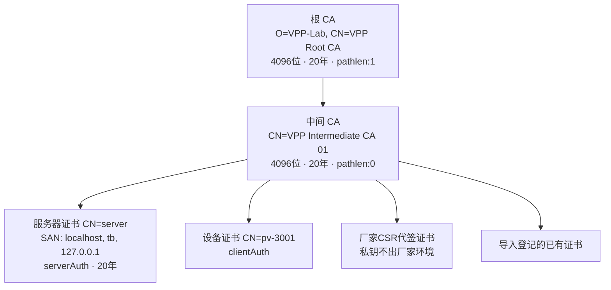
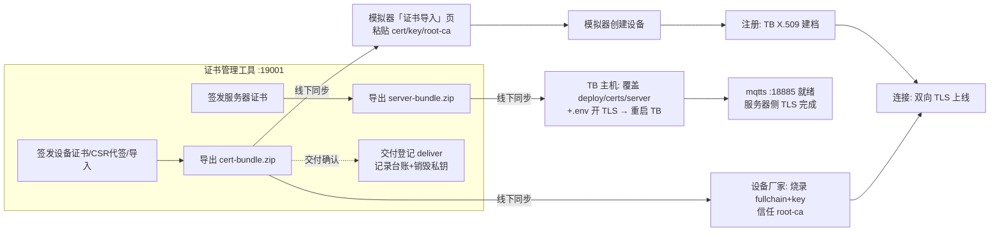

# 证书管理操作手册（certadmin 独立工具）

> 版本：v1.3 | 日期：2026-11-05 | 适用：ThingsBoard CE 3.5.1（`MQTT_SSL_ENABLED=true`，端口 18885）
> v1.3 起证书管理从设备模拟器中拆出，成为**独立小工具 certadmin**（docker-compose 单独管理，
> 可与 TB、模拟器异机部署，模拟真实"平台 CA 中心 ↔ 线下交付 ↔ 设备厂家"协作场景）。
> 本文"实测记录"均为本机真实执行结果。

## 1. 定位与架构

```
┌─────────────────┐  线下同步(人工)  ┌──────────────────┐   线下同步   ┌──────────────────┐
│ certadmin 证书管理 │ ─────────────→ │ ThingsBoard (TB)  │ ←────────── │  设备厂家(真实设备) │
│ :19001 独立主机可   │  server装配包    │ 18080 / mqtts     │  设备交付包   │  烧录证书后接入     │
│ 运行，不联网 TB    │  root-ca.pem    │ 18885             │  root-ca.pem│                   │
└─────────────────┘                └──────────────────┘              └──────────────────┘
        │ root-ca.pem + 设备交付包（线下同步）
        ▼
┌──────────────────┐
│ 设备模拟器 :19000  │  只负责：导入证书 → 创建设备 → 注册(TB 建档) → 连接(MQTTS)
└──────────────────┘
```

- **certadmin 是平台 CA 中心**：根 CA/中间 CA 签发、设备证书新增（平台代生成密钥/外部 CSR 代签/
  导入已有证书）、服务器证书签发、证书查看、链校验、导出（交付包/装配包）、交付台账与平台侧私钥销毁；
- **范围从简**：只做「新增、查看与导出」，**不含** TB 注册与撤销功能（注册由模拟器/平台侧完成，
  撤销走 TB 凭据重置，见 docs/03 v1.2 §3 的历史结论）；
- **与 TB/模拟器完全解耦**：certadmin 不调用 TB REST；所有同步均经「导出 → 线下拷贝 → 各侧导入」，
  因此它可以部署在任何一台独立主机上；
- 底层复用 `certmgr/` Python 包（`pki.py` PKI 封装 + `openssl_tool.py` openssl 命令行封装），
  certmgr CLI 保留为开发调试入口，生产操作以 certadmin Web UI 为准。

## 2. 证书体系



- 全部经 `openssl` 命令行签发（扩展经临时配置文件注入，跨 OpenSSL/LibreSSL 一致）；
- 服务器证书以 PEM 全链（证书+中间CA）挂载给 TB（`MQTT_SSL_PEM_CERT=/certs/server/server-fullchain.pem`）；
- 设备接入需持：设备证书 + 设备私钥 + 根 CA 证书（客户端校验服务器）；
- **根证书默认已生成**：certadmin 首次启动幂等初始化根 CA + 中间 CA（已存在则跳过），
  UI **不提供生成按钮**，仅可查看与导出；
- **私钥纪律**：`certadmin/data/`（含根 CA 私钥与登记簿）与 `deploy/certs/`、`deploy/.env`、
  `simulator/data/` 均在 `.gitignore` 中，**不入代码仓库**；`certadmin/data` 是全平台信任根，**务必备份**（丢失 = 全部已签发证书作废）。

### 文件布局

```
certadmin/
├── backend/                      # FastAPI（app/api.py + app/main.py）
├── frontend/index.html           # 单页 UI（Vue3 + Element Plus CDN）
├── Dockerfile / docker-compose.yml   # 独立编排（name: vpp-certadmin，19001→9001）
└── data/                         # 证书数据（不入仓库；容器内挂载为 /data/secrets）
    ├── root/ca.pem, ca_key.pem
    ├── intermediate/ca.pem, ca_key.pem, ca-chain.pem
    ├── registry.json             # 签发登记簿：名称/类型/序列号/有效期/交付台账/吊销状态
    ├── server/server.pem, server_key.pem, server-fullchain.pem
    └── devices/<name>/csr.pem, cert.pem, fullchain.pem, key.pem(交付销毁后删除)

deploy/certs/server/              # TB 侧装配目录（挂载给 TB，只读；线下覆盖）
simulator/data/certs/             # 模拟器侧证书库（线下导入；ca.pem + devices/<name>/）
```

## 3. 快速启动（独立主机亦可）

```bash
# 与 TB / 模拟器不在同一主机时：拷贝整个仓库（或 certmgr/ + certadmin/ 目录）后执行
docker compose -f certadmin/docker-compose.yml up -d --build
# 首次启动自动生成根 CA + 中间 CA（幂等）；数据持久化在 certadmin/data/
```

| 项 | 值 |
|---|---|
| Web UI / REST | `http://<certadmin主机>:19001`（`CERTADMIN_HTTP_PORT` 可改） |
| 数据目录 | `certadmin/data/` → 容器 `/data/secrets`（`CERTADMIN_SECRETS`） |
| 升级 | `docker compose -f certadmin/docker-compose.yml up -d --build`（数据在卷中不受影响） |

> 依赖网络仅为前端 CDN（Vue3/Element Plus）；后端纯本地 openssl，不对外联网。

## 4. 证书完整流程（核心）

### 4.1 流程总览



三个角色各取所需，全部经**线下人工同步**（加密传输/当面拷贝），工具之间零 API 耦合：

| 同步物 | 从 | 到 | 内容 |
|---|---|---|---|
| server-bundle.zip | certadmin | TB 主机 | server.pem / server-fullchain.pem / server_key.pem / root-ca.pem / README |
| cert-bundle.zip | certadmin | 设备厂家 | cert.pem / fullchain.pem / key.pem(未销毁时) / root-ca.pem / README |
| cert-bundle.zip | certadmin | 模拟器 | 同上（在「证书导入」页粘贴 PEM 内容） |
| root-ca.pem | certadmin | 任意接入方 | 平台信任根（也可单独 `GET /api/ca/root-ca.pem` 下载） |

### 4.2 阶段一：TB 服务器证书装配（一次性）

TB 的 mqtts 端口需要服务器证书才能提供 TLS。流程：

1. certadmin UI →「新增证书」→ 签发服务器证书（默认名称 `server`，SAN 默认
   `DNS:localhost, DNS:tb, IP:127.0.0.1`，与 deploy 编排的网络别名匹配）；
2. 列表「导出」下载 `server-server-bundle.zip`，线下拷贝到 TB 主机；
3. 覆盖 `deploy/certs/server/` 下同名文件（`server.pem / server-fullchain.pem / server_key.pem`）；
4. 确认 `deploy/.env`：
   ```ini
   MQTT_SSL_ENABLED=true
   MQTT_SSL_CREDENTIALS_TYPE=PEM
   MQTT_SSL_PEM_CERT=/certs/server/server-fullchain.pem
   MQTT_SSL_PEM_KEY=/certs/server/server_key.pem
   ```
5. 重启 TB：`docker compose -f deploy/docker-compose.yml up -d --force-recreate thingsboard`，
   mqtts 18885 即以新证书提供 TLS。

> 证书更换同理：重新签发 → 导出 → 覆盖 → 重启（README 内含这三步提示）。

### 4.3 阶段二：设备证书签发与交付（每台设备）

1. **签发**（certadmin，三种方式按场景选择）：
   - **平台生成密钥对**：「新增证书」→ 签发设备证书（名称=CN=设备名，如 `pv-3001`）；
   - **厂家 CSR 代签**：厂家自生成私钥与 CSR 提交，平台仅签证书——私钥不出厂家环境；
   - **导入已有证书**：登记厂家/第三方已有证书（需与 CN 一致）；
2. **导出**：列表「导出」下载 `cert-bundle.zip`（平台代生成密钥时含 key.pem）；
3. **线下移交**：安全渠道交给厂家（烧录）或同步给模拟器操作者；
4. **交付登记**（推荐）：行内「交付登记」→ 确认后记录 `deliveredAt` 交付时间；
   `destroyKey=true`（默认勾选）同时**销毁平台侧私钥**——TB X.509 注册与 TLS 握手只需证书，
   平台不留私钥可防沉淀泄露。销毁后列表「私钥」列显示「无」，交付包不再含 key.pem；
   私钥遗失须重新签发（旧证书仍有效，直至到期/线下约定作废）。

### 4.4 阶段三：模拟器侧接入（真实设备的等价物）

模拟器**只负责**「创建设备 + 用线下拿到的证书接入」，不再具备任何签发能力（v1.3 重构）：

1. 「证书导入」页 → 导入证书：粘贴 `cert.pem` / `key.pem`，首次使用同时粘贴 `root-ca.pem`
   （成为模拟器的平台信任根，用于校验 TB 服务器证书）；
2. 「设备管理」页 → 新建设备（名称须与证书 CN 一致，如 `pv-3001`）；创建时**不签发、不自动注册**；
3. 设备行「注册」：以已导入证书调 TB REST 建档并绑定 X.509 凭据（`credentialsType=X509_CERTIFICATE`）；
4. 设备行「连接」（或创建时自动重连）：mqtts 18885 双向 TLS 握手，TB 按 CN 匹配设备名鉴权，
   上线后心跳/遥测正常上报。

> 真实设备路径 = 厂家烧录交付包后直连 mqtts 18885（跳过 1~3 步，平台侧仍需完成 X.509 注册）。

### 4.5 撤销与过期（平台侧兜底，非 certadmin 职责)

TB CE 3.5.1 原生拒绝：过期证书（TrustManager 校验）、未注册证书（凭据精确匹配 CONNACK rc=5）、
未知 CA 证书。吊销落地 = 模拟器/平台侧将设备凭据重置为随机 ACCESS_TOKEN（原证书立即无法接入）；
certadmin 登记簿仅作台账记录（`revoke` CLI 亦保留）。详见 §7 实测用例 C 组。

## 5. certadmin UI 操作

页面区块（http://localhost:19001）：

| 区块 | 功能 |
|---|---|
| 根 CA 卡片 | 查看（详情）/ 导出 root-ca.pem；**无生成入口**（首次启动自动生成） |
| 中间 CA 卡片 | 查看 / 导出证书链 ca-chain.pem |
| 证书列表 | 名称/CN/类型/序列号/生效/到期/私钥(在册·无)/交付状态(未交付·已交付·已交付·私钥销毁)/操作 |
| 新增证书（点击弹出） | 签发设备证书（平台生成密钥对）/ 代签外部 CSR / 签发服务器证书 / 导入已有证书 |
| 行内操作 | 详情（PEM 与台账字段，私钥不外露）/ 校验链（openssl verify）/ 导出（交付包·装配包 zip）/ 交付登记 |

## 6. certadmin REST API

| 方法 | 路径 | 说明 |
|---|---|---|
| GET | `/api/health` | 健康检查（含 CA 已初始化标志） |
| GET | `/api/ca` | 根/中间 CA 信息 |
| GET | `/api/ca/root-ca.pem` | 下载根证书 |
| GET | `/api/ca/chain.pem` | 下载证书链 |
| POST | `/api/certs/device` | 签发设备证书 `{name, days=7300}`（平台生成密钥对，默认 20 年） |
| POST | `/api/certs/csr` | 代签外部 CSR `{name, csrPem, days=365}` |
| POST | `/api/certs/server` | 签发服务器证书 `{name=server, days, dns[], ips[]}` |
| POST | `/api/certs/import` | 导入已有证书登记 `{name, certPem, keyPem?}` |
| GET | `/api/certs` | 列表（隐藏文件路径，仅 hasKey 布尔） |
| GET | `/api/certs/{name}` | 详情（含 certPem；不含私钥） |
| POST | `/api/certs/{name}/verify` | 证书链校验（openssl verify 输出） |
| GET | `/api/certs/{name}/bundle` | 导出 zip（server=TB 装配包；其余=设备交付包，含 README） |
| POST | `/api/certs/{name}/deliver` | 交付登记 `{destroyKey=false}`：记录 deliveredAt；true 时销毁平台侧 key.pem |

> 无 TB 注册/撤销端点（范围约定，见 §1）；CA 私钥不经 API 暴露。

## 7. P3 实测记录（真实结果）

### 7.1 独立工具全链路（2026-11-05，certadmin v1.3）

curl/API + 浏览器 UI 双层实测，覆盖 §4 完整流程：

| # | 步骤 | 实测结果 | 判定 |
|---|---|---|---|
| 1 | 首次启动自动生成 CA | `/api/health` → `{"status":"ok","caInitialized":true}`；重启幂等不重建 | ✅ |
| 2 | 签发服务器证书 + 导出装配包 | bundle 含 server.pem / server-fullchain.pem / server_key.pem / root-ca.pem / README | ✅ |
| 3 | TB 换新证书重启 | 覆盖 deploy/certs/server → `--force-recreate` → mqtts 18885 握手 `Verification: OK` | ✅ |
| 4 | 签发设备证书 dev-ca-01 | 列表入册；`openssl verify` 链校验 OK | ✅ |
| 5 | 模拟器导入（线下同步模拟） | `POST /api/certs/import` → 模拟器证书库出现；创建设备 dev-ca-01 | ✅ |
| 6 | 注册 + 连接 | TB 凭据 `X509_CERTIFICATE`；mqtts 双向 TLS 上线，遥测落地（hbSeq=3, runState=2） | ✅ |
| 7 | 交付登记 + 私钥销毁 | `deliver {destroyKey:true}` → 台账 deliveredAt/keyDestroyedAt；bundle 无 key.pem；设备仍在线（平台销钥不影响已交付设备） | ✅ |
| 8 | 模拟器旧签发端点移除 | `/api/certs/device` 405、`tb-register` 404（v1.2 接口已下线） | ✅ |
| 9 | UI 全流程 | CA 卡片/列表/状态标签、新增证书（点击下拉 4 项）、签发对话框提交→列表刷新、详情抽屉（PEM/台账，私钥不外露）、导出请求、模拟器「证书导入」页与导入对话框，全部真实点击验证 | ✅ |

### 7.2 认证安全用例（2026-11-03，P3 门禁，certmgr 时代实测，行为与 TB 版本相关仍有效）

| # | 用例 | 实测结果 | 判定 |
|---|---|---|---|
| A1 | 证书链校验 | `openssl verify` root/intermediate/server 全 OK；SAN/EKU 符合 | ✅ |
| A2 | TLS 握手 | s_client 18885：服务器证书 `CN=server` ← `CN=VPP Intermediate CA 01`，Verify return code 0 | ✅ |
| B1 | 设备注册绑定 | TB 设备创建 + 凭据 X509_CERTIFICATE | ✅ |
| B2 | **X.509 双向认证接入** | 证书连接 18885 + QoS1 遥测，TB 回读一致 | ✅ |
| C-A | 未注册证书接入 | CONNACK rc=5 拒绝 | ✅ |
| C-B | 过期证书接入 | CONNACK rc=5；TB 日志 `Invalid Device Certificate` | ✅ |
| C-C | 未知 CA 证书接入 | CONNACK rc=5 拒绝 | ✅ |
| C-D | 吊销落地 | 凭据重置 ACCESS_TOKEN 后 CONNACK rc=5 | ✅ |

**P3 门禁结论：通过**（双向 TLS 成功用例 + 3 类失败用例 + 吊销落地全部实测）。

## 8. v1.3 与旧版（v1.2 模拟器内置）差异

| 项 | v1.2（模拟器内置证书管理页） | v1.3（certadmin 独立工具） |
|---|---|---|
| 部署形态 | 模拟器进程内 API + tab | 独立容器/独立主机，docker-compose 单独管理 |
| 证书存放 | certmgr/secrets（模拟器可读写） | certadmin/data（CA 根信任源，模拟器不可触达） |
| 模拟器职责 | 签发+导入+注册+连接 | **仅导入+注册+连接**（签发能力移除） |
| TB 服务器证书 | certmgr CLI 签发直写 deploy/certs | certadmin 签发 → 导出装配包 → 线下覆盖 |
| 新增能力 | — | 交付台账+私钥销毁迁移至此；范围精简为新增/查看/导出 |
| 接口变化 | `/api/certs/device`、`/api/certs/csr`、`/api/certs/{n}/tb-register` 等 | 模拟器侧全部移除（405/404），certadmin 提供上表 API |

> 迁移注意：旧 `certmgr/secrets/` 数据不再被主流程使用；如需保留历史证书，可在 certadmin
> 「导入已有证书」逐张登记。
