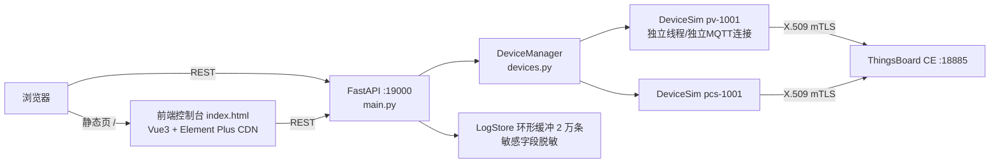

# 设备模拟器使用说明（P4）

> 版本：v1.0 | 日期：2026-11-03 | 适用：模拟器后端（FastAPI，19000）+ 前端控制台（Vue3 单页）
> 本文所有能力均在 ThingsBoard CE 3.5.1（18885 双向 TLS）环境中实测，实测记录见
> `tests/results_p4.json`（模拟器联调）与 `tests/results_p5.json`（平台侧验证）。

## 1. 概述与架构

模拟器面向 3.1/3.2 需求：批量模拟 PV 逆变器 / PCS 储能 / 柔性负荷接入平台，
支持 1min/15min 周期遥测、心跳、断线缓存补传、RPC 指令闭环（M12/M13/M14）、
共享属性回执（M06）、异常注入与全量报文日志（脱敏）。



- 每台设备一个 `DeviceSim` 实例：独立证书、独立 MQTT 连接（client_id=`sim-<name>`）、独立故障注入，互不影响；
- 网络收发单线程化：所有 `publish`/`disconnect` 经出站队列由设备工作线程统一执行
  （paho-mqtt 1.6.1 的 `publish()` 直写 socket，跨线程并发写同一 SSL 对象会引发
  OpenSSL 段错误——本工程已规避并实测验证）；
- 数据模型：PV 按 `(6−x−0.4·sin)·P/6` 正弦曲线发电；PCS 双向充放电含 SOC/单压/循环次数；
  1min 遥测整分对齐（M03），15min 电能增量（M04），补传批量 M06。

## 2. 快速启动

前置：TB 容器已运行（REST 18080 / MQTT over TLS 18885），证书体系已初始化
（见 docs/03）。在仓库根目录：

```bash
# Linux / macOS
.venv/bin/python -m uvicorn app.main:app --host 0.0.0.0 --port 19000 \
  --app-dir simulator/backend

# Windows
.venv\Scripts\python -m uvicorn app.main:app --host 0.0.0.0 --port 19000 --app-dir simulator\backend
```

- 健康检查：`curl http://localhost:19000/api/health` → `{"status":"ok","mqtt":{"port":18885},...}`
- 前端控制台：浏览器打开 `http://localhost:19000/`（后端启动时检测 `simulator/frontend/index.html` 存在即自动挂载）
- 环境变量：`MQTT_HOST`（默认 localhost）、`MQTT_PORT`（默认 18885）、`TB_URL`（默认 http://localhost:18080）、`SIM_SECRETS_DIR`（默认 `certmgr/secrets`）、`TB_USER/TB_PASS`（默认 tenant 账号）

## 3. REST API

### 3.1 基础与设备管理

| 方法/路径 | 说明 |
|---|---|
| `GET /api/health` | 健康检查：进程/存储/后端连接参数/设备数 |
| `POST /api/devices` | 创建设备。body：`{name, devType: pv\|pcs\|flex, capKw, autoRegister=true, autoConnect=true}`；`autoRegister` 时自动签发设备证书（已存在则复用）并注册 TB（X.509 凭据绑定，TB 侧 get→缺则建 幂等）。**同名重复创建幂等**：直接复用现有设备实例，返回 `register="reuse-existing"`，不重复签发/注册 |
| `GET /api/devices` | 设备列表摘要（连接态/功率/心跳/缓存/故障等） |
| `GET /api/devices/{name}` | 设备详情（运行状态 + 全量配置） |
| `DELETE /api/devices/{name}` | 删除设备（断开连接并回收线程） |
| `POST /api/devices/{name}/connect` | 连接/重连平台 |
| `POST /api/devices/{name}/disconnect` | 主动断开（后续手动重连才恢复） |

### 3.2 曲线调参（POST /api/devices/{name}/curve）

`{capKw, rampRate, socMin, socMax, chgPMax, disPMax}` 任选字段；
调整后自动同步 `pMin/pMax`（pv: `[0,capKw]`，pcs: `[-capKw,capKw]`）。

### 3.3 异常注入（POST /api/devices/{name}/inject）

| mode | 生效对象 | 参数 | 行为 |
|---|---|---|---|
| `disconnect` | 连接 | `durationSec` | 断线 N 秒，期间数据遥测（M03/M04/M05）进缓存，恢复后 M06 批量补传 |
| `delay` | 全部上行 | `durationSec`+`ms` | 报文延迟 |
| `duplicate` | M03~M06 | `count` | 同一报文连发 2 次（QoS1 重复投递） |
| `badJson` | M03~M06 | `count` | 报文截断为非法 JSON → 平台侧解析失败（TB 将主动断链） |
| `missingField` | M03~M06 | `count`+`field` | 删除指定字段（默认 `p`） |
| `outOfRange` | M03~M06 | `count`+`key`+`value` | 字段越界（默认 p=99999） |
| `rejectCmd` | 下一条指令 | `count` | 指令拒绝：回 `REJECTED 2003` |
| `failCmd` | 下一条指令 | `count` | 指令执行失败：回 `FAILED 2003`（模拟运行条件不满足，见规范第 9 章；2005 为幂等命中） |

数据报文类故障（M03~M06）不影响心跳（M02）与指令应答（M13/M14），保证注入期间
指令链路与保活仍可验证。断线补传缓存上限 1536 条（≥24h：1440×1min + 96×15min），溢出丢弃并计 `cacheOverflow`。

### 3.4 台账与日志

| 方法/路径 | 说明 |
|---|---|
| `GET /api/devices/{name}/ledger` | 指令台账：cmdId → {state, errCode, data, ts}（ACK/EXECUTING/SUCCESS/FAILED/REJECTED） |
| `GET /api/devices/{name}/sent` | 设备上行报文日志 |
| `GET /api/logs?device=&direction=&msgType=&q=&limit=` | 全量日志查询（direction: in/out/evt；最新在前） |
| `GET /api/logs/export?fmt=json\|csv` | 日志导出（同上过滤参数） |

日志字段：`{seq, ts, deviceId, direction, topic, qos, msgType, cmdId, payload, result, error, latencyMs}`；
敏感键名（password/secret/token/privateKey/credential）与 PEM 私钥内容自动替换为 `***REDACTED***`。

### 3.5 证书管理（/api/certs，封装 certmgr）

| 方法/路径 | 说明 |
|---|---|
| `GET /api/certs`、`GET /api/certs/{name}` | 登记簿列表 / 详情（含 certPem） |
| `GET /api/certs/expiry?days=30` | 临期预警 |
| `POST /api/certs/device` | 签发设备证书 `{name, days}` |
| `POST /api/certs/csr` | 厂家 CSR 代签 `{name, csrPem, days}` |
| `POST /api/certs/{name}/verify` | 证书链校验（openssl verify 输出） |
| `POST /api/certs/{name}/revoke` | 吊销登记 `{reason, tbRevoke}`（`tbRevoke=true` 时同步重置 TB 凭据为随机 ACCESS_TOKEN） |
| `POST /api/certs/{name}/tb-register` | 注册/更新 TB 设备凭据 `{type}` |

### 3.6 平台侧验证控制台（/api/verify，P5）

封装 TB REST 完成需求第四章 7 项验证，所有判定基于 TB 实际存储/响应，不依赖模拟器自身日志：

| 方法/路径 | 说明 |
|---|---|
| `GET /api/verify/devices` | 7.1 设备注册/连接/认证状态（TB active + credentialsType） |
| `GET /api/verify/telemetry/latest?device=&keys=` | 7.2 最新遥测（TB 存储回读） |
| `GET /api/verify/telemetry/history?device=&keys=&startTs=&endTs=` | 7.2 历史遥测 |
| `POST /api/verify/attributes` / `GET /api/verify/attributes` | 7.3 共享属性下发 / 设备 CLIENT_SCOPE 应用回执读取 |
| `POST /api/verify/rpc` | 7.4/7.5 召测与控制指令（two-way RPC，body：`{device, method, env:{cmdId,issuedAt,expireAt,params}}`） |
| `GET /api/verify/ledger?device=` | 7.6 指令响应双端对照（平台 cmdState/actualP + 模拟器指令台账） |
| `POST /api/verify/compare` | 7.7 发送 vs 接收完整性比对（按 ts 逐点核对，verdict=PASS/FAIL） |

## 4. 前端控制台（http://localhost:19000/）

四个页签，2 秒自动刷新当前页：

| 页签 | 功能 |
|---|---|
| 设备管理 | 设备表格（连接/运行态/功率/SOC/心跳/缓存/故障徽标）、新建设备（类型+容量）、连接/断开、曲线调参对话框、指令台账抽屉、删除 |
| 异常注入 | 目标设备选择 + 8 种故障卡片（时长/次数字段联动）+ 当前活跃故障标签展示 |
| 证书管理 | 证书列表（序列号/有效期/状态）、签发设备证书、厂家 CSR 代签、链校验、TB 注册、吊销、临期预警（默认 30 天）、详情抽屉（PEM 查看） |
| 报文日志 | 设备/方向/报文类型/关键字过滤、自动刷新开关、payload 展开、JSON/CSV 导出 |

## 5. 模拟器 ↔ TB 联调实测（P4）

实测脚本：`tests/verify_p4.py`（真实链路：模拟器 → mTLS 18885 → TB → REST 18080 断言）。
最新结果：`tests/results_p4.json`。

### 5.1 实测结论

**#11 轮（2026-11-03）：18/18 全部通过**，用例累计执行约 10.9 分钟（设备运行与爬坡等待计入各用例耗时）。
实测链路：模拟器（FastAPI :19000）→ mTLS :18885 → ThingsBoard CE 3.5.1 → REST :18080 历史库断言，
全部为真实交互取证（平台侧以 TB 存储结果为准），无任何模拟结果替代。

### 5.2 用例实测明细（#11 轮）

| 编号 | 用例 | 实测结果摘要 | 耗时 |
|---|---|---|---|
| P4-01 | 健康检查 | MQTT 18885 参数正确回显 | 1ms |
| P4-02 | 设备创建+证书签发+TB 注册 | pv-1001/pcs-1001 创建，TB 凭据=X509_CERTIFICATE | 1.0s |
| P4-03 | 双向 TLS 上线 | 双设备 connected，hbSeq=1 | 1.0s |
| P4-04 | 1min 遥测入库 | 4 条/4min，ts 整分对齐，dqf∈[0,3]，latest p=30.0 s=30.27 | <0.1s（含前置轮询） |
| P4-05 | PCS SOC 测点 | soc/soh/cellVMax/cycCnt 全部入库，soc=34.38 | 10ms |
| P4-06 | 共享属性下发 | cfgVerApplied=1 cfgResult=0，心跳周期 30s→20s 生效 | 1.2s |
| P4-07 | cfgVer 重复拒绝 | cfgResult=1002 | 2.1s |
| P4-08 | 召测 readRealtimeData | M13 SUCCESS，M05 召测遥测入库 | 0.8s |
| P4-09 | 控制 setActivePowerTarget | ACK→SUCCESS actualP=79.5，平台 p 爬坡至 ≈80.0 | 113s（含爬坡等待） |
| P4-10 | 指令幂等 | 同 cmdId 重发 dup=true 返回原结果 | 1.5s |
| P4-11 | 过期指令 | REJECTED errCode=2004 | 1.0s |
| P4-12 | PCS 充放电闭环 | SUCCESS actualP=-49.86，平台 p=-50.0，soc=58.87 | 178s（含 600s 放电指令台账等待） |
| P4-13 | 断线→缓存→补传 | cached=4，1 批补传，平台 200s 窗口核实 4 条 | 141s（含断线时长） |
| P4-14 | 历史召测 readHistoryData | plannedBatches=1 records=9，平台 e_exp_15 核实 9 点 | 0.6s |
| P4-15 | 异常注入组合 | 缺字段点+越界 99999 点均入库，拒令 REJECTED 2003，坏报文 TB 断链 | 158s |
| P4-16 | 指令执行失败闭环 | cmdState=FAILED errCode=2003（爬坡完成后注入生效） | 53s |
| P4-17 | 日志倒序/导出 | 50 条倒序，CSV 233976B | 34ms |
| P4-18 | 证书 REST | 8 项登记，openssl verify 通过 | 45ms |

### 5.3 调试轮次轨迹（定位 → 修复 → 实测复验）

| 轮次 | 结果 | 暴露问题与根因 | 修复措施 |
|---|---|---|---|
| #7 | 17/18 | two-way RPC 409：TB active 标志与会话注册存在秒级竞态 | 测试脚本增加在线等待 + 409 兜底重试 |
| #8 | 17/18 | **毒报文死循环**：坏 JSON 以 QoS1 发布后进入 paho 在途队列，TB 拒收（日志 417）主动断链；每次重连 paho 自动重发未确认报文 → 约 2s/周期永久断链，TB 会话永不注册 | 畸形报文改 QoS0（坏 JSON 不具备 QoS1 确认语义）+ 连续异常断链 ≥3 次自动清空在途队列（毒报文防御，devices.py `_on_disconnect`） |
| #9 | 16/18 | ① M04 同 ts 覆盖：越界注入点恰逢 15min 整刻时，后写的 M04 结算值被 TB 按"同 key 同 ts 末写胜出"覆盖注入点；② 本 TB 版本 active 字段仅在 `/api/device/info/{id}` 返回（详情/分页列表接口均无） | ① 注入 count 1→2（相邻两分钟点不可能同为整刻边界）；② tb_client 新增 `get_device_info` 走 info 接口 |
| #10 | 17/18 | P4-16 FAILED 超时：测试脚本 s11 缺少 failCmd 注入调用，设备正常执行返回 SUCCESS | s11 在 RPC 发出前补注入 `failCmd count=1` |
| #11 | **18/18** | — | 全部通过 |

### 5.4 实测确认的平台行为（P5/P6 注意事项）

- **遥测异步落库**：MQTT ACK ≠ REST 查询可见（rule chain 落库有秒级延迟），断言一律轮询；
- **坏 JSON 断链**：TB 收到非法 JSON 主动断链（日志 `invalid publish msg ... [417]`），属平台真实行为；
- **同 ts 末写胜出**：TB 遥测同 key 同 ts 后写覆盖先写，15min 结算（M04）会覆盖同刻 1min 点（M03）；
- **active 字段口径**：TB CE 3.5.1 仅 `/api/device/info/{id}` 返回 active，`/api/device/{id}` 与分页列表均不含；
- **two-way RPC 409**：设备离线或 active 标志竞态时 TB 返回 409，需在线等待后重试；
- **LOGS 环形缓冲**：模拟器日志 2 万条滚动，长跑取证需及时导出。

## 6. 平台侧验证实测（P5）

实测脚本：`tests/verify_p5.py`（经验证控制台 `/api/verify/*` → TB REST :18080，判定全部基于 TB 存储回读）。
最新结果：`tests/results_p5.json`。

### 6.1 实测结论

**#1 轮（2026-11-03）：7/7 全部通过**，累计执行约 88 秒（P5-06 含功率爬坡等待）。
需求第四章 7 项逐项覆盖：注册认证状态、最新/历史遥测、共享属性、召测、远程控制、
指令响应与执行数据、发送/接收完整性比对。

### 6.2 用例实测明细（#1 轮）

| 编号 | 用例（需求 4.x） | 实测结果摘要 | 耗时 |
|---|---|---|---|
| P5-01 | 4.1 注册/连接/认证状态 | pv-1001/pcs-1001：TB active=true，credentialsType=X509_CERTIFICATE | 271ms |
| P5-02 | 4.2 最新遥测与历史数据 | PV p/s/dqf latest 齐全；5min 历史 p=5 条整分对齐；PCS soc=43.99 | 258ms |
| P5-03 | 4.3 共享属性下发与应用 | cfgVer=2 应用成功（cfgVerApplied=2，cfgResult=0），心跳周期→30s | 1.4s |
| P5-04 | 4.4 数据召测 | readRealtimeData SUCCESS p=30.0，TB p 遥测 ts 前移（M05 入库） | 0.8s |
| P5-05 | 4.5 远程控制指令受理 | setActivePowerTarget(60kW) → ACK（cmdId=v5-pt-…） | 0.9s |
| P5-06 | 4.6 指令响应与执行数据 | 平台 cmdState=SUCCESS，actualP=59.5，TB p 爬坡到位 60.0（容差 ±1.5） | 84.3s（含爬坡） |
| P5-07 | 4.7 发送/接收完整性比对 | M03 窗口 300s：sent=5 / matched=5 / missing=0 / mismatch=0 → PASS | 94ms |

### 6.3 判定依据

- P5-01：TB `active` 标志 + X.509 凭据类型（双向 TLS 唯一证据）；
- P5-02~P5-06：一律以 TB REST 存储回读为准（遥测历史/latest、CLIENT_SCOPE 属性回执、
  latest 遥测 ts 前移作为 M05 入库证据），轮询等待异步落库；
- P5-06 执行数据三重核验：平台 `cmdState=SUCCESS`（本轮时间戳之后）+ `actualP` 上报 +
  TB p 遥测爬坡到位目标值 ±1.5；
- P5-07 完整性比对：发送侧取模拟器日志 `result=sent` 的 M03 原始 payload，接收侧取
  TB 历史库窗口点，按 ts 对齐逐点核对数值（容差仅防浮点误差）。

## 7. 已知行为与约束

- **paho 1.6.1 网络循环**：采用自管 loop（工作线程 tick 调 `loop(0)` + 出站队列 flush），
  规避了其 `loop_start()` 线程在主动断开后死亡、以及跨线程 publish 并发写 SSL 的两个缺陷；
- **TB 对坏 JSON 的反应**：遥测主题收到非法 JSON 时 TB 主动断开连接（`missingField/badJson`
  注入期间表现为设备离线，恢复注入后自动重连并补传，此为平台侧真实行为，已在 P4 实测）；
- **two-way RPC 设备离线**：TB 返回 409，需设备在线后重试（测试脚本已内置在线等待）；
- **补传语义**：断线期间仅数据遥测（M03/M04/M05）缓存，心跳不缓存；恢复后按 M06 分批补传
  （每批 ≤50 条，间隔 2s），补传完成发 `replay-done` 事件日志；
- **共享属性回执**：设备应用配置后上报 `cfgVerApplied/cfgResult/cfgApplyTs`（M06），
  重复 `cfgVer` 回 `cfgResult=1002` 拒绝。
