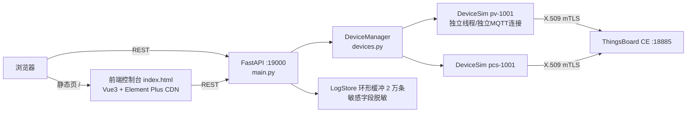

# 设备模拟器使用说明（P4）

> 版本：v1.0 | 日期：2026-11-03 | 适用：模拟器后端（FastAPI，19000）+ 前端控制台（Vue3 单页）
> 本文所有能力均在 ThingsBoard CE 3.5.1（18885 双向 TLS）环境中实测，实测记录见 `tests/results_p4.json`。

## 1. 概述与架构

模拟器面向 3.1/3.2 需求：批量模拟 PV 逆变器 / PCS 储能 / 柔性负荷接入平台，
支持 1min/15min 周期遥测、心跳、断线缓存补传、RPC 指令闭环（M12/M13/M14）、
共享属性回执（M06）、异常注入与全量报文日志（脱敏）。



- 每台设备一个 `DeviceSim` 实例：独立证书、独立 MQTT 连接（client_id=`sim-<name>`）、独立故障注入，互不影响；
- 网络收发单线程化：所有 `publish`/`disconnect` 经出站队列由设备工作线程统一执行
  （paho-mqtt 1.6.1 的 `publish()` 直写 socket，跨线程并发写同一 SSL 对象会引发
  OpenSSL 段错误——本工程已规避并实测验证）；
- 数据模型：PV 按 `(6−x−0.4·sin)·P/6` 正弦曲线发电；PCS 双向充放电含 SOC/单压/循环次数；
  1min 遥测整分对齐（M03），15min 电能增量（M04），补传批量 M06。

## 2. 快速启动

前置：TB 容器已运行（REST 18080 / MQTT over TLS 18885），证书体系已初始化
（见 docs/03）。在仓库根目录：

```bash
# Linux / macOS
.venv/bin/python -m uvicorn app.main:app --host 0.0.0.0 --port 19000 \
  --app-dir simulator/backend

# Windows
.venv\Scripts\python -m uvicorn app.main:app --host 0.0.0.0 --port 19000 --app-dir simulator\backend
```

- 健康检查：`curl http://localhost:19000/api/health` → `{"status":"ok","mqtt":{"port":18885},...}`
- 前端控制台：浏览器打开 `http://localhost:19000/`（后端启动时检测 `simulator/frontend/index.html` 存在即自动挂载）
- 环境变量：`MQTT_HOST`（默认 localhost）、`MQTT_PORT`（默认 18885）、`TB_URL`（默认 http://localhost:18080）、`SIM_SECRETS_DIR`（默认 `certmgr/secrets`）、`TB_USER/TB_PASS`（默认 tenant 账号）

## 3. REST API

### 3.1 基础与设备管理

| 方法/路径 | 说明 |
|---|---|
| `GET /api/health` | 健康检查：进程/存储/后端连接参数/设备数 |
| `POST /api/devices` | 创建设备。body：`{name, devType: pv\|pcs\|flex, capKw, autoRegister=true, autoConnect=true}`；`autoRegister` 时自动签发设备证书（已存在则复用）并注册 TB（X.509 凭据绑定） |
| `GET /api/devices` | 设备列表摘要（连接态/功率/心跳/缓存/故障等） |
| `GET /api/devices/{name}` | 设备详情（运行状态 + 全量配置） |
| `DELETE /api/devices/{name}` | 删除设备（断开连接并回收线程） |
| `POST /api/devices/{name}/connect` | 连接/重连平台 |
| `POST /api/devices/{name}/disconnect` | 主动断开（后续手动重连才恢复） |

### 3.2 曲线调参（POST /api/devices/{name}/curve）

`{capKw, rampRate, socMin, socMax, chgPMax, disPMax}` 任选字段；
调整后自动同步 `pMin/pMax`（pv: `[0,capKw]`，pcs: `[-capKw,capKw]`）。

### 3.3 异常注入（POST /api/devices/{name}/inject）

| mode | 生效对象 | 参数 | 行为 |
|---|---|---|---|
| `disconnect` | 连接 | `durationSec` | 断线 N 秒，期间数据遥测（M03/M04/M05）进缓存，恢复后 M06 批量补传 |
| `delay` | 全部上行 | `durationSec`+`ms` | 报文延迟 |
| `duplicate` | M03~M06 | `count` | 同一报文连发 2 次（QoS1 重复投递） |
| `badJson` | M03~M06 | `count` | 报文截断为非法 JSON → 平台侧解析失败（TB 将主动断链） |
| `missingField` | M03~M06 | `count`+`field` | 删除指定字段（默认 `p`） |
| `outOfRange` | M03~M06 | `count`+`key`+`value` | 字段越界（默认 p=99999） |
| `rejectCmd` | 下一条指令 | `count` | 指令拒绝：回 `REJECTED 2003` |
| `failCmd` | 下一条指令 | `count` | 指令执行失败：回 `FAILED 2005` |

数据报文类故障（M03~M06）不影响心跳（M02）与指令应答（M13/M14），保证注入期间
指令链路与保活仍可验证。断线补传缓存上限 1536 条（≥24h：1440×1min + 96×15min），溢出丢弃并计 `cacheOverflow`。

### 3.4 台账与日志

| 方法/路径 | 说明 |
|---|---|
| `GET /api/devices/{name}/ledger` | 指令台账：cmdId → {state, errCode, data, ts}（ACK/EXECUTING/SUCCESS/FAILED/REJECTED） |
| `GET /api/devices/{name}/sent` | 设备上行报文日志 |
| `GET /api/logs?device=&direction=&msgType=&q=&limit=` | 全量日志查询（direction: in/out/evt；最新在前） |
| `GET /api/logs/export?fmt=json\|csv` | 日志导出（同上过滤参数） |

日志字段：`{seq, ts, deviceId, direction, topic, qos, msgType, cmdId, payload, result, error, latencyMs}`；
敏感键名（password/secret/token/privateKey/credential）与 PEM 私钥内容自动替换为 `***REDACTED***`。

### 3.5 证书管理（/api/certs，封装 certmgr）

| 方法/路径 | 说明 |
|---|---|
| `GET /api/certs`、`GET /api/certs/{name}` | 登记簿列表 / 详情（含 certPem） |
| `GET /api/certs/expiry?days=30` | 临期预警 |
| `POST /api/certs/device` | 签发设备证书 `{name, days}` |
| `POST /api/certs/csr` | 厂家 CSR 代签 `{name, csrPem, days}` |
| `POST /api/certs/{name}/verify` | 证书链校验（openssl verify 输出） |
| `POST /api/certs/{name}/revoke` | 吊销登记 `{reason, tbRevoke}`（`tbRevoke=true` 时同步重置 TB 凭据为随机 ACCESS_TOKEN） |
| `POST /api/certs/{name}/tb-register` | 注册/更新 TB 设备凭据 `{type}` |

## 4. 前端控制台（http://localhost:19000/）

四个页签，2 秒自动刷新当前页：

| 页签 | 功能 |
|---|---|
| 设备管理 | 设备表格（连接/运行态/功率/SOC/心跳/缓存/故障徽标）、新建设备（类型+容量）、连接/断开、曲线调参对话框、指令台账抽屉、删除 |
| 异常注入 | 目标设备选择 + 8 种故障卡片（时长/次数字段联动）+ 当前活跃故障标签展示 |
| 证书管理 | 证书列表（序列号/有效期/状态）、签发设备证书、厂家 CSR 代签、链校验、TB 注册、吊销、临期预警（默认 30 天）、详情抽屉（PEM 查看） |
| 报文日志 | 设备/方向/报文类型/关键字过滤、自动刷新开关、payload 展开、JSON/CSV 导出 |

## 5. 模拟器 ↔ TB 联调实测（P4）

实测脚本：`tests/verify_p4.py`（真实链路：模拟器 → mTLS 18885 → TB → REST 18080 断言）。
最新结果：`tests/results_p4.json`。

<!-- RESULTS_PLACEHOLDER -->

## 6. 已知行为与约束

- **paho 1.6.1 网络循环**：采用自管 loop（工作线程 tick 调 `loop(0)` + 出站队列 flush），
  规避了其 `loop_start()` 线程在主动断开后死亡、以及跨线程 publish 并发写 SSL 的两个缺陷；
- **TB 对坏 JSON 的反应**：遥测主题收到非法 JSON 时 TB 主动断开连接（`missingField/badJson`
  注入期间表现为设备离线，恢复注入后自动重连并补传，此为平台侧真实行为，已在 P4 实测）；
- **two-way RPC 设备离线**：TB 返回 409，需设备在线后重试（测试脚本已内置在线等待）；
- **补传语义**：断线期间仅数据遥测（M03/M04/M05）缓存，心跳不缓存；恢复后按 M06 分批补传
  （每批 ≤50 条，间隔 2s），补传完成发 `replay-done` 事件日志；
- **共享属性回执**：设备应用配置后上报 `cfgVerApplied/cfgResult/cfgApplyTs`（M06），
  重复 `cfgVer` 回 `cfgResult=1002` 拒绝。
