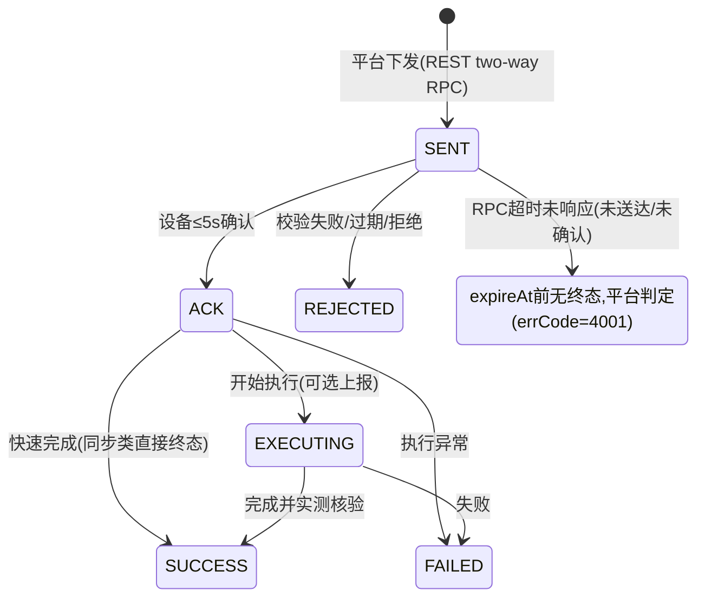

# 虚拟电厂物联设备通信与接入技术规范（终稿）

> **文档状态：终稿 v1.0（已批准，随 P7 交付）** | 日期：2026-11-04
> 汇编来源：`docs/01-物联交互报文规范.md`（P1 人工批准基线 v1.0，2026-11-03）+ P2~P6 实施阶段实测修正
> 适用平台：ThingsBoard CE 3.5.1（固定镜像 `thingsboard/tb-postgres:3.5.1`，升级需重新确认）
> 配套交付：机器可读 Schema `spec/schemas/`；字段级完整示例与时序图全集见 docs/01；实测数据与用例明细见 docs/05
> 本文档为 P7 交付终稿，已与代码、Schema、部署文件完成一致性核对（见 §10 验证记录）

---

## 1. 范围

本规范规定虚拟电厂（VPP）平台与接入设备（光伏逆变器 `pv`、储能 PCS `pcs`、负荷 `load`（v1.2 前称 flex）、风电 `wind`）之间基于 MQTT over TLS 的全部交互报文、接入认证与证书体系、数据口径、控制指令闭环及性能验收要求，作为设备厂家适配依据与本项目开发、测试、验收基准。

## 2. 系统组成与部署形态

### 2.1 组件清单

| 组件 | 形态 | 职责 |
|---|---|---|
| 物联平台 | ThingsBoard CE 3.5.1 单容器（内嵌 PostgreSQL 12，无独立数据库容器） | MQTT 接入/鉴权、遥测属性存储、RPC 路由、设备会话管理 |
| 证书管理 certmgr | Python（CLI + REST 封装），openssl 体系 | PKI 签发/登记/吊销名单、TB 设备注册与 X.509 凭据绑定 |
| 设备模拟器 | FastAPI :19000（前后端一体，paho-mqtt 1.6.1） | 多设备接入（每台独立证书独立 MQTT 连接）、功率曲线、故障注入、报文日志、验证控制台 |
| 自动化测试 | pytest（`tests/p6/`） | 30 例用例集，1/10/100 三档并发，机器可读结果 + HTML 报告 |
| 一键脚本 | `scripts/vpp.sh`（macOS/Linux）/ `scripts/vpp.ps1`（Windows，兼容 pwsh Unix） | init/start/stop/restart/status/logs/test/backup |

### 2.2 端口分配（对外统一 1xxxx，避免主机冲突）

| 对外端口 | 内部端口 | 用途 | 默认状态 |
|---|---|---|---|
| **18080** | 容器 9090 | TB Web UI / REST API | 开启 |
| **18885** | 容器 8883 | **MQTT over TLS（X.509 双向认证）— 主接入** | 开启（P3 起） |
| 18886 | 容器 1883 | MQTT 明文（仅调试） | 默认关闭（debug 编排开启） |
| **19000** | 9000 | 模拟器 / 验证控制台 | 开启 |
| — | 5432 | PostgreSQL | 不对外（容器内 localhost） |

> 端口变更说明：原规划 MQTTS 18883、明文 18884，因本机既有服务占用，P2 实测后调整为 18885/18886（可在 `deploy/.env` 修改）。本规范全文对外端口一律为 **18885**。

### 2.3 部署编排要点（deploy/docker-compose.yml）

- 固定镜像 `thingsboard/tb-postgres:3.5.1`；命名卷 `vpp-tb-data`（/data，含内嵌 PG 数据）、`vpp-tb-logs`；健康检查 `wget /login`（start_period=300s）；`restart: unless-stopped`；日志轮转 json-file 200MB×10；
- TB 服务网络别名 **`tb`**：服务器证书 SAN 含 `DNS:tb`，容器内模拟器经 `tb:8883` 接入时服务器主机名校验通过（P7 容器化冒烟实测）；
- 模拟器两种运行形态（二选一）：
  - **宿主机进程**（默认，脚本采用）：`.venv` 内 uvicorn :19000，日志 `tests/sim_uvicorn.log`；
  - **容器化**：`docker compose --profile simulator up -d --build`，镜像 `vpp-simulator:1.0.0`（`deploy/simulator.Dockerfile`，构建上下文=仓库根），端口 `${SIM_HTTP_PORT:-19000}:9000`，挂载 `certmgr/secrets` 只读，`SIM_MQTT_HOST=tb`、`SIM_MQTT_PORT=8883`、`TB_URL=http://thingsboard:9090` 由编排注入；
- 环境变量：`deploy/.env`（模板 `deploy/.env.example`：端口、`JAVA_OPTS`、`TZ`、模拟器镜像/端口等）。

### 2.4 一键脚本（scripts/vpp.sh 与 scripts/vpp.ps1）

| 子命令 | 行为 |
|---|---|
| `init` | 依赖检查（docker/compose v2/openssl/python3）→ 生成 `deploy/.env`（如无）→ 创建 `.venv` 并安装 certmgr/模拟器/pytest 依赖 |
| `start` | `docker compose up -d` → 轮询 TB 就绪（最长 300s，首启建库 1~3 分钟）→ 启动模拟器（幂等：端口已监听则跳过）→ 输出状态总览 |
| `stop` | 停模拟器（pid 优雅→强杀）→ `docker compose stop`（保留容器与数据卷） |
| `restart` | = stop + start |
| `status` | TB 容器状态 / HTTP 探测 / MQTT TLS 端口 / 模拟器 health / 测试产物清单 |
| `logs [tb\|sim]` | 跟踪 TB compose 日志或模拟器 uvicorn 日志 |
| `test [规模]` | 规模=1 全量 30 例；>1 仅并发用例组（`-m scale`） |
| `backup` | 停 TB → alpine 容器 tar 打包 `vpp-tb-data` 卷 → `backups/vpp-tb-data-<时间戳>.tgz` → 原 running 则自动启动并等就绪 |

Windows：`scripts/vpp.ps1` 提供等价八个子命令（TLS 端口探测用 TcpClient，Windows 下模拟器经 `Start-Process -WindowStyle Hidden` 启动；pwsh Unix 分支经 `sh -c 'nohup … &'` 守护）。两脚本均读取 `deploy/.env` 端口覆盖。

## 3. 接入安全规范（PKI 与认证）

### 3.1 证书体系（certmgr 签发，四级）

| 证书 | 主体 | 密钥/有效期 | 用途 |
|---|---|---|---|
| 根 CA | `O=VPP-Lab, CN=VPP Root CA` | RSA 4096，20 年（7300 天），pathlen:1 | 信任锚 |
| 中间 CA | `CN=VPP Intermediate CA 01` | RSA 4096，20 年（7300 天），pathlen:0 | 签发服务器/设备证书 |
| 服务器证书 | `CN=server`；**SAN = DNS:localhost, DNS:tb, IP:127.0.0.1**；EKU serverAuth | 7300 天（20 年） | TB MQTTS 端侧证书（挂载容器 /certs） |
| 设备证书 | `CN=设备名`（如 `pv-0001`，与 TB 设备名一致） | 默认 7300 天（20 年，`--days` 可配） | 设备侧 TLS 客户端证书 |

- 私钥仅存 `certmgr/secrets/`（不入代码仓库）；`registry.json` 签发登记簿记录名称/序列号/有效期/吊销状态；`expiry --days N` 临期检查；
- **吊销**：TB 3.5.1 CE 无原生 CRL/OCSP 页面，采用 certmgr 吊销名单 + REST 禁用设备凭据（禁用设备等效吊销）。

### 3.2 设备注册与凭据绑定（平台预注册模型）

1. 设备厂家生成密钥对与 CSR（CN=设备名）；
2. certmgr 用中间 CA 签发设备证书，导出证书+私钥+证书链（root+intermediate）；
3. certmgr 调 TB REST：创建设备（名称=CN，设备配置文件按 devType 对应 profile）→ 凭据类型置 `X509_CERTIFICATE`，值=**base64(DER)**（TB 3.5.1 存储格式，已实测与签发证书 DER 逐字节比对一致）；
4. 设备首次 MQTT 连接成功即激活，激活后必发 M01。

### 3.3 MQTT CONNECT 参数

| 参数 | 值 | 说明 |
|---|---|---|
| host:port | 平台地址:**18885**（TLS 1.2+） | |
| clientId | `dev-{CN}`，全局唯一 | 重复将互踢（后连挤前连） |
| username / password | 空 / 任意 | 以证书认证 |
| clientCert | 设备证书 + 中间 CA + 根 CA 证书链（PEM） | |
| clientKey | 设备私钥 | 不入代码仓库 |
| keepAlive | 60s（可配 30~120s） | 1.5×keepAlive 无报文平台断开 |
| cleanSession | false | 断线期间订阅由 TB 会话保持 |
| 连接后立即订阅 | T3、T4、T7（QoS 1） | 未订阅 RPC 时指令无法送达 |

### 3.4 TLS 实现行为与失败处理（TB 3.5.1 实测差异，设备厂家必读）

- TB 3.5.1 MQTT TLS 握手层为 **WANT 客户端认证**（`setNeedClientAuth(false)` 硬编码，无配置项）：无证书或伪造 CA 证书的 TLS 握手均可建立；**设备认证与证书信任在 MQTT CONNECT 层强制**——按证书指纹检索设备凭据，未注册指纹返回 CONNACK rc≠0 并关闭连接；
- 失败场景与实测结果：

| 场景 | 实测结果 | 设备处理 |
|---|---|---|
| 未注册指纹 / 伪造 CA 证书 | MQTT CONNECT 被拒（CONNACK rc≠0）或连接关闭 | 指数退避重连（1s 起×2，上限 60s，±20% 抖动） |
| 证书过期 | CONNACK **rc=5**；TB 日志 `CertificateException: Invalid Device Certificate`（TrustManager 有效期校验） | 退避重试，≥5 次后停止重试、转本地告警等待人工换证 |
| 凭据未绑定 / 设备被禁用（等效吊销） | 会话被拒/断开 | 同退避重连 |

### 3.5 在线状态判定（TB 3.5.1 实测行为）

设备 `active` **非断链事件驱动**：由 TB 每 60s 周期按 `inactivityTimeout` 判定（镜像默认 600s；本项目设备配置文件已下调为 **60s**；支持设备级 SERVER_SCOPE 属性 `inactivityTimeout`（毫秒）覆盖且即时生效，实测 30s 配置在 30~90s 内翻转 false）。设备真实上下线以 TB 会话事件与 active 为准；业务心跳（M02）仅证明应用层进程健康。

## 4. 通信协议规范

### 4.1 协议基础

| 项 | 约定 |
|---|---|
| 传输协议 | MQTT 3.1.1，MQTT over TLS（TLS 1.2+），对外端口 **18885**，X.509 双向认证 |
| 报文编码 | UTF-8，JSON（RFC 8259）；数值必须是 JSON number，禁止字符串数字 |
| Topic | 仅使用 TB 原生 Topic（telemetry/attributes/rpc/claim），**不允许自定义 TB 无法识别的 Topic**，业务语义全部承载于 payload 字段 |
| 时间戳 | `ts` 统一 UTC 毫秒级 epoch（13 位整数） |
| 命名 | 业务键小驼峰；遥测键短小写（`p`、`e_imp` 等，见 §5） |
| QoS | 全部业务报文 QoS 1；订阅必须 QoS≥1 |
| 单包 | ≤32 KB；历史批量补传 ≤100 条/包 |
| 协议版本 | `protocolVer = "vpp-1.0"`（M01 上报） |

### 4.2 Topic 总表（全部 TB 原生）

| # | Topic | 方向 | 用途 | 报文 |
|---|---|---|---|---|
| T1 | `v1/devices/me/telemetry` | 设备→平台 | 遥测：周期数据、心跳、告警、指令状态、实时快照、历史批量 | M02~M06、M11、M14 |
| T2 | `v1/devices/me/attributes` | 设备→平台 | 客户端属性上报 | M01、M07 |
| T3 | `v1/devices/me/attributes`（订阅） | 平台→设备 | 共享属性下发 | M08 |
| T4 | `v1/devices/me/attributes/delete`（订阅） | 平台→设备 | 共享属性删除通知 | M09 |
| T5/T6 | `v1/devices/me/attributes/request|response/{reqId}` | 设备⇄平台 | 属性拉取（可选） | M10 |
| T7 | `v1/devices/me/rpc/request/{reqId}`（订阅） | 平台→设备 | 服务端 RPC：召测/参数/控制 | M12 |
| T8 | `v1/devices/me/rpc/response/{reqId}` | 设备→平台 | RPC 即时响应 | M13 |
| T9 | `v1/devices/me/rpc/request/{reqId}` | 设备→平台 | 客户端 RPC 对时（可选） | M16 |
| T10 | `v1/devices/me/claim` | 设备→平台 | 设备认领（可选） | M15 |

> `{reqId}` 由发起方给出；RPC 响应必须原样回填同一 `reqId`（TB 配对规则）。

### 4.3 消息清单与规范性要求

| 编号 | 名称 | 方向 | 载体 | 必发时机 / 触发 | 关键必填与硬性约束 |
|---|---|---|---|---|---|
| M01 | 设备信息上报 | 设备→平台 | 客户端属性 | 首次连接激活后必发；型号/版本变更后必发 | `devSn/devName/devType/devModel/protocolVer="vpp-1.0"/capKw`；平台 60s 未收到视为档案不完整 |
| M02 | 业务心跳 | 设备→平台 | 遥测 | 周期默认 30s（`hbPeriodSec` 可配 10~300） | `msgType="hb"`、`hbSeq` 单调递增、`runState`、`ctrlMode`；连续缺失 ≥3 周期业务可疑（真上下线以 TB 会话为准，见 §3.5） |
| M03 | 1 分钟周期遥测 | 设备→平台 | 遥测 | 每分钟周期末（整分，±2s，超差 `dqf=1`） | 必填 `p`、`dqf`；无有效数据的测点**省略键**且 `dqf≥1`，禁止 null/0 顶替；连续 ≥3 周期缺测发 M11(3001) |
| M04 | 15 分钟周期遥测 | 设备→平台 | 遥测 | 每 15 分钟整刻末（分∈{0,15,30,45}，±2s） | 在 M03 基础上加 `e_imp/e_exp`（累计表码）、`e_imp_15/e_exp_15`（区间增量）、`e_day`（PV/PCS 必报，UTC+8 日复位）；首周期省略增量；表码倒走非回绕 `dqf=2` + M11(3002) |
| M05 | 召测联动实时快照 | 设备→平台 | 遥测 | `readRealtimeData` 成功后 **≤2s** | 格式同 M03，`ts`=召测时刻（可不为整分），键集与 M13 `data` 一致 |
| M06 | 历史数据批量补传 | 设备→平台 | 遥测数组 | 断线重连后自主补传 / `readHistoryData` 回放 | TB 原生数组 `[{ts,values},…]`，**≤100 条/包、包间 ≥200ms、按时间升序**；保持缓存原值原 dqf 不得插值；缓存 ≥24h，溢出丢最旧 + M11(3003)；平台按 ts 幂等去重 |
| M07 | 调节能力与约束上报 | 设备→平台 | 客户端属性 | 变化即发，且至少每 15min 刷新 | 键集见 §5.3（PCS 必报 soc 边界与充放功率）；15min 未刷新平台视为约束过期 |
| M08 | 共享属性下发 | 平台→设备 | 共享属性 | 平台配置变更 | `cfgVer` 必填且单调递增；设备**整体原子校验**，**10s 内**回报 `cfgVerApplied/cfgApplyTs/cfgResult`；版本回退拒绝（1002）；平台 30s 未确认标记下发未确认 |
| M09 | 共享属性删除通知 | 平台→设备 | TB 原生 | 平台删除共享属性 | `{"deleted":["key"]}`；设备恢复该键默认值 |
| M10 | 属性拉取 | 设备⇄平台 | TB 原生 | 可选（设备启动对齐配置） | 10s 未响应重试 ≤3 次 |
| M11 | 告警/异常上报 | 设备→平台 | 遥测 | 告警产生/恢复时（恢复必发、同 `alarmId`） | `alarmId/alarmCode/alarmLevel/alarmTs/alarmActive` 必填；本地持久化队列不可丢弃；去重键 alarmId+alarmTs；字典见 §5.2 |
| M12 | 控制指令下发 | 平台→设备 | 服务端 RPC | 平台发起（REST two-way，timeout=10000ms） | 信封 `cmdId`（**全局唯一幂等键**）+`issuedAt`+`expireAt`（默认 +60s）+`params`；RPC `method`=`cmdType`；过期指令直接 REJECTED(2004) |
| M13 | 指令即时响应 | 设备→平台 | RPC 响应 | 收到 M12 后 **≤5s**（任何状态） | `cmdId/state/errCode/ts` 必填；查询类 ≤5s 返回终态+`data`；幂等命中置 `dup=true` |
| M14 | 指令状态/终态上报 | 设备→平台 | 遥测 | `EXECUTING` 可选；**终态必发且在 `expireAt` 前** | `cmdState∈{EXECUTING,SUCCESS,FAILED}`；终态必带实测键（控制有功→`actualP`、限功率→`actualPLimit`、充放电→`actualP`+`soc`、启停/模式→`runState`、参数→`applied`）；执行中断线重连后**补报终态** |
| M15 | 设备认领 | 设备→平台 | TB 原生 | 可选（租户/客户绑定） | 本项目默认不启用 |
| M16 | 设备对时 | 设备⇄平台 | 客户端 RPC | 可选（校验兜底，设备须自备 NTP） | 偏差 >2s 发 M11(4001) |

代表示例（完整示例与 Schema 见 docs/01 第 4 章及 `spec/schemas/`）：

```json
// M03 1 分钟遥测（PCS，周期末整分）
{ "ts": 1699000020000,
  "values": { "u": 380.2, "i": 759.8, "f": 50.001, "pf": 0.998, "p": 498.65, "q": 22.31,
              "s": 499.5, "t_dev": 45.2, "t_amb": 28.5, "soc": 82.4, "runState": 4, "dqf": 0 } }
```

```json
// M06 历史批量补传（原生遥测数组，升序，原值原 dqf）
[
  { "ts": 1699000020000, "values": { "p": 480.12, "u": 380.5, "dqf": 0 } },
  { "ts": 1699000080000, "values": { "p": 492.77, "u": 380.1, "dqf": 0 } }
]
```

```json
// M12 指令信封（RPC method=setActivePowerTarget；REST 请求体 {"method":"setActivePowerTarget","params":{信封},"timeout":10000}）
{ "cmdId": "CMD-20261103-0001", "issuedAt": 1699000000000, "expireAt": 1699000060000,
  "params": { "targetP": 400.0, "rampRate": 250.0, "durationS": 900 } }

// M13 即时响应（≤5s）
{ "cmdId": "CMD-20261103-0001", "state": "ACK", "errCode": 0, "errMsg": "", "ts": 1699000001200 }

// M14 终态（expireAt 前，必带实测）
{ "ts": 1699000035000,
  "values": { "msgType": "cmdStatus", "cmdId": "CMD-20261103-0001", "cmdType": "setActivePowerTarget",
              "cmdState": "SUCCESS", "errCode": 0, "errMsg": "",
              "execTs": 1699000012000, "costMs": 3200, "actualP": 399.85 } }
```

### 4.4 控制指令闭环

状态机（平台台账 + 设备上报双侧记录，以 `cmdId` 关联）：



指令清单（`cmdType` = RPC `method`）：

| cmdType | 名称 | params 要点 | 响应方式 |
|---|---|---|---|
| `readRealtimeData` | 实时数据召测 | 无（可选 `keys`） | 同步：M13 SUCCESS+`data`，随后 ≤2s 发 M05 |
| `readHistoryData` | 历史数据召测 | `startTs/endTs` 必填、`interval`(1/15min)、`callId` 必填 | 同步元信息：M13 返回 `plannedBatches/records`，随后 M06 批量回放 |
| `getDeviceParams` | 参数查询 | `keys`（缺省=全部） | 同步：M13 SUCCESS+`data` |
| `setDeviceParams` | 参数配置 | 参数键值对（≤20 键） | 异步：ACK → M14 终态（`applied`） |
| `setActivePowerTarget` | 有功目标值 | `targetP` 必填（受 §5.3 约束）、`rampRate`、`durationS` | 异步：ACK → M14 终态（`actualP`） |
| `setMaxPowerLimit` | 最大功率限制 | `maxP`（0~capKw）、`scope`∈{gen,chg,dis} | 异步：ACK → M14 终态（`actualPLimit`） |
| `setRunMode` | 启停/模式 | `action`∈{start,stop} 与 `mode`∈{auto,manual} 至少一项 | 异步：ACK → M14 终态（`runState`） |
| `setChargeDischargePower` | 充放电功率 | `p`（**正=放电，负=充电**）、`durationS`、`socFloor/socCeil` | 异步：ACK → M14 终态（`actualP`+`soc`） |

幂等与超时规则：

- 设备维护指令台账（cmdId→终态，保留 ≥24h）：已终态 cmdId 重发→按原终态应答并 `dup=true`，**不得重复执行**；执行中重发→回 ACK/EXECUTING；平台同 cmdId 禁止二次下发，重试必须换新 cmdId；
- M13 即时响应 ≤5s（平台 REST timeout 10000ms，超时判 TIMEOUT 未送达）；异步终态 ≤`expireAt`（默认下发后 60s），未收到判 TIMEOUT(4001)；迟到终态仍入台账并标"迟到"；
- 执行核验：SUCCESS 且 |targetP−actualP| ≤ max(2%·|targetP|, 约束分辨率) 判核验通过，且需另有 M05/周期数据佐证（不采信发送日志）；
- 并发约束：同一设备同一时刻**至多 1 个控制类指令执行中**，执行中收到新控制指令 → REJECTED(2002)；查询类不受限。

### 4.5 错误码总表

| errCode | 含义 | 适用 | 处理 |
|---|---|---|---|
| 0 | 成功 | 全部 | — |
| 1001 | 参数缺失 | 指令 | REJECTED/FAILED，errMsg 注明缺哪个 |
| 1002 | 参数非法/越界 | 指令/属性 | REJECTED；共享属性→cfgResult=1002 整体拒绝 |
| 1003 | 设备内部错误 | 指令/上报 | FAILED，是否重试由平台决定 |
| 1004 | 不支持的命令类型 | 指令 | REJECTED（新 cmdType 不得静默丢弃） |
| 1005 | 报文格式错误（JSON 解析失败） | 指令 | REJECTED |
| 2001 | 设备未就绪（停机/检修） | 控制类 | REJECTED |
| 2002 | 忙碌（已有控制指令执行中） | 控制类 | REJECTED |
| 2003 | 运行条件不满足（SOC 越限、电网异常等） | 控制类 | REJECTED 或执行中 FAILED |
| 2004 | 指令已过期 | 控制类 | REJECTED |
| 2005 | 重复指令 | 全部 | 幂等命中，返回原结果（dup=true） |
| 3001 | 与下级/子设备通信故障 | 上报 | M11 |
| 4001 | 平台超时判定 | 台账 | 平台生成，非设备上报 |

## 5. 数据字典

### 5.1 电气量与电量（M03/M04/M05/M06）

| 键 | 名称 | 单位 | 精度 | 范围 | 必填 |
|---|---|---|---|---|---|
| u / i | 交流电压/电流 | V / A | 0.1 / 0.01 | 0~100000 / 0~10000 | 否 |
| **p** | 有功功率 | kW | 0.01 | ±100000（负=充电/受电） | **是** |
| q / s | 无功/视在功率 | kvar / kVA | 0.01 | ±100000 / 0~150000 | 否 |
| pf / f | 功率因数/频率 | - / Hz | 0.001 | −1~1 / 45~65 | 否 |
| t_dev / t_amb | 设备/环境温度 | ℃ | 0.1 | −60~150 | 否 |
| e_imp / e_exp | 受进/送出电量（累计表码） | kWh | 0.001 | 0~99999999.999 | 15min 必填 |
| e_imp_15 / e_exp_15 | 区间电量增量 | kWh | 0.001 | 0~99999.999 | 有基线后必填 |
| e_day | 当日累计（UTC+8 日 0 点复位） | kWh | 0.001 | 0~999999.999 | M04，PV/PCS 必填 |

### 5.2 运行状态与告警字典

runState：0 未知 / 1 待机 / 2 运行发电 / 3 充电(PCS) / 4 放电(PCS) / 5 停机(人为) / 6 故障停机 / 7 检修 / 8 受限运行(限功率中)。

| alarmCode | 含义 | 级别 | alarmCode | 含义 | 级别 |
|---|---|---|---|---|---|
| 1001 | 下级/子设备通信中断 | 3 | 3001 | 周期数据连续缺失 | 2 |
| 1002 | 采样/传感器故障 | 3 | 3002 | 数据越界（超物理范围被拒） | 2 |
| 1003 | 内部存储故障 | 3 | 3003 | 补传缓存溢出 | 2 |
| 1004 | 本地时钟同步失败 | 2 | 4001 | 对时偏差 >2s | 1 |
| 2001~2005 | 电压/电流/频率/温度/功率越限 | 3 | 9001 | 其他（alarmDesc 必填） | 2 |

> alarmCode 与 errCode 命名空间独立；恢复事件（alarmActive=false）复用同一 alarmId。

### 5.3 调节能力与运行约束（M07）

| 键 | 说明 | 键 | 说明 |
|---|---|---|---|
| pMin/pMax | 有功上下限（kW，pMin 可为负） | socMin/socMax | SOC 边界（%，仅 PCS 必报） |
| rampRate | 爬坡速率（kW/min，>0） | chgPMax/disPMax | 最大充/放电功率（kW，仅 PCS 必报，随 SOC 动态变化须即时刷新） |
| qMin/qMax | 无功上下限（kvar） | respTimeS | 指令响应预期（s，1~300） |
| ctrlMode | 0 本地/1 远程 | regMode / upTimeS | auto/manual；可持续调节时长（−1=不限） |

指令参数校验依据：`pMin≤targetP≤pMax`；`|ΔP|>rampRate×durationS` 时按 rampRate 爬坡至目标；充放电受 chgPMax/disPMax 与 SOC 边界约束，越界 → REJECTED(1002)。

### 5.4 设备类型专用键（可选上报）

- **pv**：`dc_u/dc_i`（直流 V/A）、`dc_p`（直流功率 kW）、`irradi`（辐照度 W/m²）、`t_mod`（组件温度 ℃）；
- **pcs**：`soc/soh`（%/0.1 精度）、`cellVMax/cellVMin`（V，0.001）、`cellTMax/cellTMin`（℃）、`cycCnt`（循环次数）；
- **load**（负荷，v1.2 起，前称 flex）：`loadType`（负荷分类码，编码表：1 一般负荷 / 2 生产负荷 / 3 照明负荷 / 4 空调负荷 / 5 安保负荷 / 6 充电桩负荷 / 7 办公负荷 / 99 其他负荷；devType=load 必填，建档时登记）、`adjUpCap/adjDownCap`（可调容量 kW）、`shedState`（0/1/2）；
- **wind**（风电，v1.2 新增，与 pv 并列的发电类设备）：`windSpeed`（实时风速 m/s，0~60）；有功出力随风速变化（三次方模型，p≥0），`capKw` 为装机容量，平均风速经模拟器负荷特征接口配置（`windSpeedAvg`，默认 8 m/s，可配 1~25）。

### 5.5 统计口径、质量标识与异常数据

| 数据 | ts | 口径 |
|---|---|---|
| 1min（M03） | 周期末整分 ±2s | 分钟内有功瞬时平均（内部采样 ≥1 次/10s）；u/i 为 RMS 平均 |
| 15min（M04） | 整刻末 ±2s | 15min 平均功率 + 累计表码（周期末值）+ 区间增量（末−初） |

- **dqf 数据质量标识（报文级必填）**：0 全部有效 / 1 可疑（时间不对齐等） / 2 无效周期（缺测键已省略） / 3 补录插值（仅补传沿用原值标注；平台插值只用于展示层）；
- 测点无效→省略键 + `dqf≥2`，禁止 null/0 顶替；连续 ≥3 周期缺测→M11(3001)；越界→拒测点 + M11(3002)；
- **表码回绕**（上限 99999999.999）：`增量=末−初`；若 `末<初 且 初>90000000` → `增量=末+(99999999.999−初)+0.001`；
- **换表清零**：先发 M11(9001, alarmDesc 含 `meterReset`) 并置客户端属性 `meterResetTs`，平台重置基线；
- 首周期无基线：`e_*_15` 省略仅报表码；净电量口径 `e_exp−e_imp`；
- 补传旧数据会覆盖 TB latest telemetry，平台取数一律按**时间范围查询**（验证控制台已按此实现）。

## 6. 参数总表（默认值与可配范围）

| 参数 | 默认 | 可配 | 说明 |
|---|---|---|---|
| MQTT KeepAlive | 60s | 30~120s | 协议层 |
| hbPeriodSec 心跳周期 | 30s | 10~300s（共享属性） | 连缺 ≥3 周期业务可疑 |
| M13 即时响应时限 | 5s | 固定 | 设备保证 |
| 平台 REST RPC timeout | 10000ms | ≥5000ms | TB 默认 |
| expireAt 有效期偏移 | issuedAt+60s | 按指令覆盖 | 终态时限 |
| 属性应用时限 | 10s | 固定 | 收到 M08→回报 |
| 约束刷新 | ≤15min | 变化即发 | M07 |
| 补传批量/间隔 | ≤100 条 / ≥200ms | 固定 | 升序，QoS1 |
| 设备缓存 | ≥24h | 可配 | 1440 条 1min + 96 条 15min，溢出丢最旧 |
| inactivityTimeout（TB） | 600s（本项目 profile=60s） | 设备级属性覆盖 | active 周期判定见 §3.5 |
| 重连退避 | 1,2,4,…,≤60s | 固定 | ±20% 抖动 |

## 7. 性能指标与实测结果（P6，详见 docs/05）

### 7.1 测试环境（每轮由 conftest 自动采集写入结果）

| 项 | 值 |
|---|---|
| 平台 | ThingsBoard CE 3.5.1（Docker `vpp-thingsboard`，REST :18080 / MQTTS :18885） |
| 模拟器 | uvicorn :19000（paho-mqtt 1.6.1，每设备独立证书独立连接） |
| 硬件 | MacBook Air（arm64，10 核，16GB），macOS 27.2，Python 3.12.7 |
| 用例集 | 30 例（功能 25 + 并发规模 5），覆盖需求第五章 9 类 |

### 7.2 三档并发实测结果（2026-11-04，真实运行）

| 指标 | S=1 | S=10 | S=100 |
|---|---|---|---|
| 用例通过率 | **30/30（100%）**，833.7s | 5/5（100%），6.4s | 5/5（100%），26.8s |
| 批量创建+签发+TB 注册 | — | 10/10，180ms/台 | 100/100，**85ms/台**（8.5s） |
| 并发上线（TB active 全真） | — | 10/10，1.1s | 100/100，0.6s |
| 首轮遥测 latest 可见 | — | 10/10 | 100/100 |
| 并发召测成功率 / RTT min/avg/**p95**/max | 1.29s | 100%，0.86/1.10/**1.29**/1.34s | 100%，0.36/0.69/**1.02**/1.37s |
| 结果产物 | `tests/results_p6_s1.json` | `results_p6_s10.json` | `results_p6_s100.json` + `report_p6.html` |

### 7.3 指标基线说明

- 召测端到端 RTT p95 ≤ 1.3s（实测 1.02~1.29s），满足协议 M13 ≤5s 时限并留 4 倍裕度；
- 批量注册 ≤200ms/台（S=100 实测 85ms/台，含证书签发+TB REST 注册）；
- 100 台并发上线收敛 ≤2s；全部轮次成功率 100%；
- 需求第五章要求记录项（硬件条件、持续时间、成功率、RTT 分布 min/avg/p95/max）已全部落入结果 JSON 与 HTML 报告；
- 轮次轨迹与已知平台行为（WANT 模式、active 周期判定、paho 1.6.1 竞态加固）见 docs/05 §5.4，均为真实迭代记录。

## 8. 版本与兼容性

- 协议版本 `protocolVer="vpp-1.0"`；新增可选键不升版；删除/改义键、新增必填键必须升版并全量回归；
- 新增 `cmdType` 时设备应回 REJECTED(1004) 而非静默丢弃；
- 本规范与代码/Schema 同步：修改必须同步更新 `spec/schemas/`、模拟器、测试用例，并在 §11 变更记录登记。

## 9. 交付物清单与文档索引

| 交付物 | 路径 |
|---|---|
| 总体规划 | `docs/00-项目总体规划.md` |
| 报文规范基线（示例/时序图全集） | `docs/01-物联交互报文规范.md` |
| 架构与部署手册 | `docs/02-系统架构与部署手册.md` |
| 证书管理操作手册 | `docs/03-证书管理操作手册.md` |
| 模拟器使用说明（含联调实测） | `docs/04-模拟器使用说明.md` |
| 自动化测试方案与用例（含三档实测） | `docs/05-自动化测试方案与用例.md` |
| **本规范（终稿）** | `docs/虚拟电厂物联设备通信与接入技术规范.md` |
| 机器可读 Schema | `spec/schemas/*.json`（15 个，与 docs/01 同步） |
| 部署编排 | `deploy/`（compose、debug-mqtt 覆盖、simulator.Dockerfile、.env.example） |
| 一键脚本 | `scripts/vpp.sh`、`scripts/vpp.ps1` |
| 证书管理器 | `certmgr/`（CLI + TB REST 绑定，secrets 不入库） |
| 模拟器 | `simulator/backend`（FastAPI）+ `simulator/frontend`（Vue3 构建产物） |
| 自动化测试 | `tests/p6/`（30 例）+ `tests/results_p6_s*.json` + `tests/report_p6.html` |
| 快速上手 | `README.md` |

## 10. 一致性核对与验证记录（P7 门禁）

| 核对项 | 结果 | 证据（均为真实执行） |
|---|---|---|
| 本规范端口/行为与实现一致（18080/18885/18886/19000、别名 tb、WANT 模式、base64(DER)） | ✓ | 与 `deploy/`、`docs/02/03/05` 逐一比对；docs/01 遗留的 18883 笔误已修正 |
| Schema 与模拟器/测试一致 | ✓ | P4/P6 用例以 jsonschema 校验真实报文，30/30 通过 |
| 一键脚本（bash 语法/compose config） | ✓ | `bash -n`、`docker compose config` 校验通过 |
| 脚本 start/stop/restart/status/logs（macOS） | ✓ | 实跑：TB healthy、模拟器 health 200、pid 文件正确 |
| Windows 脚本 vpp.ps1 | ✓ | pwsh 8 实跑 init 依赖检查/start/status（macOS 交叉验证 Unix 分支；Windows 原生分支按同构实现） |
| `vpp.sh test`（scale=1 全量） | ✓ | 真实 pytest 30/30（脚本通路与手工命令结果一致） |
| `vpp.sh backup` | ✓ | 真实备份 `backups/vpp-tb-data-20261104-*.tgz`（约 16MB）并自动恢复 TB |
| 模拟器容器化全链路 | ✓ | 镜像真实构建；冒烟：创建 p7-smoke → `cert-issued+tb-registered` → 5s 内 MQTT TLS 连接（经 `tb:8883` 主机名校验）→ 清理 |
| 未验证项 | — | Windows 原生环境（无 Windows 机器，ps1 Windows 分支未在真机执行；pwsh Unix 路径已实测） |

## 11. 变更记录

| 日期 | 变更 | 依据 |
|---|---|---|
| 2026-11-03 | P1 报文规范 v1.0 获人工批准（docs/01 基线） | 阶段门禁 |
| 2026-11-04 | P2~P6 实测修正并入：对外端口 18885/18886、TB 内嵌 PG、WANT 模式/CONNECT 层认证、active 周期判定、inactivityTimeout 覆盖 | docs/02~05 实测记录 |
| 2026-11-04 | P7 终稿汇编发布：并入 PKI 参数、部署形态/端口表/一键脚本、性能实测（§7）与一致性核对（§10） | 需求第八章 P7 门禁 |
| 2026-11-04 | 交付后变更（用户指令）：全部证书默认有效期统一为 20 年（7300 天，CLI 与 API 双层默认值），§3.1 同步；已签发证书不受影响，换发须删除旧签发记录重签并重新绑定 TB | `certmgr/cli.py`、`certmgr/pki.py` 实改并运行验证 |
| 2026-11-04 | v1.2 功能迭代：devType 枚举 `flex` 更名 `load`（负荷）并新增 `wind`（风电），§1/§5.4 同步；loadType 编码表落地（devType=load 必填）；配套模拟器能力：负荷特征配置（baseRatio/noiseAmp/dutyOnMin/dutyOffMin/windSpeedAvg）、手动证书+手动注册（autoRegister=false → csr/import → register）、日志 direction（in/out/evt）与 raw 原始报文；新增迭代用例 TC-IT-01~06 全部实测通过 | `spec/schemas/_common.schema.json`、`simulator/backend/app/*.py`、`tests/p6/test_c10_iter.py` |
| 2026-11-05 | 交付后调整（用户指令）：loadType 编码表调整为 1 一般负荷 / 2 生产负荷 / 3 照明负荷 / 4 空调负荷 / 5 安保负荷 / 6 充电桩负荷 / 7 办公负荷 / 99 其他负荷（§5.4 同步）；模拟器特征曲线与校验（1~7,99）、前端下拉、schemas 与 TC-IT-01 用例随新表更新 | `simulator/backend/app/{curves,main,devices}.py`、`simulator/frontend/index.html`、`spec/schemas/_common.schema.json`、`tests/p6/test_c10_iter.py` 实改并运行验证 |
